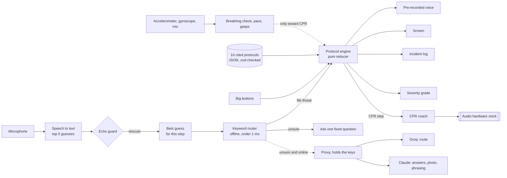

# Mayday: everything

**Mayday talks a panicking bystander through a medical emergency, out loud and step by step, while help is on the way, even with no signal.**

This document describes everything Mayday does, every problem it addresses, how each feature works, how each one was tested, and what is still not done. It is written for judges, teammates, a medical reviewer, and anyone reading the code for the first time. Shorter documents go deeper on single topics; they are linked where they apply.

Congressional App Challenge 2026. Built in October 2026 with Expo (React Native, TypeScript) for iPhone and Android, with a web build that runs on any computer inside a life-size iPhone frame, and an installable home-screen version for iPhone Safari.

> **Mayday never calls 911, or anyone.** It has no code that can dial or text a number, it does not ask for the phone permission, and a test fails the build if any of that is ever added. You make the call; Mayday tells you what to say.

---

## Contents

1. [The short version](#1-the-short-version)
2. [The problems Mayday addresses](#2-the-problems-mayday-addresses)
3. [Who it is for](#3-who-it-is-for)
4. [What using it looks like, start to finish](#4-what-using-it-looks-like-start-to-finish)
5. [The screens](#5-the-screens)
6. [The ten protocols, step by step](#6-the-ten-protocols-step-by-step)
7. [Talk to Mayday: the voice assistant](#7-talk-to-mayday-the-voice-assistant)
8. [Understanding many Englishes: accents, dialects and mishearings](#8-understanding-many-englishes-accents-dialects-and-mishearings)
9. [Answers to questions, and quick guides](#9-answers-to-questions-and-quick-guides)
10. [The voice adapts; the medicine does not](#10-the-voice-adapts-the-medicine-does-not)
11. [The voice itself](#11-the-voice-itself)
12. [The CPR coach](#12-the-cpr-coach)
13. [Feeling the CPR pace with the phone](#13-feeling-the-cpr-pace-with-the-phone)
14. [The breathing check: the phone on the chest](#14-the-breathing-check-the-phone-on-the-chest)
15. [The Breathe tab](#15-the-breathe-tab)
16. [Hearing gasps](#16-hearing-gasps)
17. [The heartbeat model (lab only)](#17-the-heartbeat-model-lab-only)
18. [Severity grading](#18-severity-grading)
19. [911, 112, and the dispatcher card](#19-911-112-and-the-dispatcher-card)
20. [The map and the right hospital](#20-the-map-and-the-right-hospital)
21. [Regions: Lagos, where Mayday helps most](#21-regions-lagos-where-mayday-helps-most)
22. [The incident log and the paramedic handoff](#22-the-incident-log-and-the-paramedic-handoff)
23. [Medical ID and settings](#23-medical-id-and-settings)
24. [Practice CPR](#24-practice-cpr)
25. [The photo check](#25-the-photo-check)
26. [Design](#26-design)
27. [Works with no signal](#27-works-with-no-signal)
28. [On an iPhone without the App Store](#28-on-an-iphone-without-the-app-store)
29. [Where AI is used, and where it is not allowed](#29-where-ai-is-used-and-where-it-is-not-allowed)
30. [The proxy: keys never ship in the app](#30-the-proxy-keys-never-ship-in-the-app)
31. [Safety rules the build enforces](#31-safety-rules-the-build-enforces)
32. [Medical sources](#32-medical-sources)
33. [Testing and evidence](#33-testing-and-evidence)
34. [The desktop phone and the Engine panel](#34-the-desktop-phone-and-the-engine-panel)
35. [Architecture and code](#35-architecture-and-code)
36. [Tools and languages](#36-tools-and-languages)
37. [Data sources and credits](#37-data-sources-and-credits)
38. [Privacy](#38-privacy)
39. [Accessibility](#39-accessibility)
40. [Known limitations](#40-known-limitations)
41. [How Mayday meets the CAC judging criteria](#41-how-mayday-meets-the-cac-judging-criteria)
42. [What 2.0 would add](#42-what-20-would-add)
43. [How it was built: the timeline](#43-how-it-was-built-the-timeline)
44. [Running it](#44-running-it)
45. [Glossary](#45-glossary)

---

## 1. The short version

You open Mayday and tap **Talk to Mayday**, or the colored tile for what is happening. You say "my dad collapsed and he's not breathing." Mayday answers out loud, asks at most one question, and coaches you through the right protocol: one picture, one short instruction, big answer buttons, and a calm voice. **Back**, **Talk** and **911** sit under your thumb on every step.

What it covers:

- **Ten protocols, 78 cited steps:** adult, child and infant CPR; adult and child choking; infant choking; severe bleeding; burns; stroke (FAST); opioid overdose with naloxone; the recovery position.
- **Five quick guides** for emergencies with no full protocol: seizures, allergic reactions, low blood sugar, heat stroke and chest pain.
- **A CPR coach** that counts every compression out loud at 110 a minute on the phone's audio hardware clock (zero drift over ten minutes), cues breaths if you are trained, tells you when to swap rescuers, and switches to AED steps the moment you say "the AED is here".
- **The phone as a sensor:** lay it on the chest and it reads breathing from its own tilt to a hundredth of a degree; during CPR it feels your pushes and tells you to go faster or slower; it can listen for gasps. Every sensor can only ever push toward CPR, never tell you someone is fine.
- **Severity grading** (Level 1 Mild, 2 Serious, 3 Critical, and a burn's degree) for choking, bleeding, burns, stroke and overdose.
- **A 911 card** with your street address, GPS coordinates and a one-line summary of what happened, to read to the dispatcher. It never dials.
- **A map that knows which hospital:** 145 Florida emergency rooms, all 36 Florida trauma centers with their levels, urgent care marked "not for emergencies", and 514 hospitals and health centres in Lagos, Nigeria. All offline.
- **Regions:** in Lagos the app says and shows 112 instead of 911, and explains with sourced figures why the bystander matters most there.
- **It understands many Englishes:** the recognizer's top five guesses, dialect forms ("yeah nah", "aye", "ain't", "he's gone blue", "keeled over"), and common mishearings ("not breeding", "chalking").
- **A timestamped log** for the paramedics, and a Medical ID that stays on the phone.
- **Everything that keeps someone alive works in airplane mode.**

The rule under all of it: **the AI never writes medical instructions.** Every instruction comes from a protocol file with the guideline sentence it encodes, checked by tests.

---

## 2. The problems Mayday addresses

### 2.1 People die waiting for help while the person beside them doesn't know what to do

From the CARES 2024 Metrics Summary (Cardiac Arrest Registry to Enhance Survival):

- **137,119** out-of-hospital cardiac arrests were reported to CARES in 2024.
- **71.3%** happened at home. The person who collapses is usually someone's dad, wife or grandparent, not a stranger.
- Only **41.7%** of patients got CPR from a bystander.
- Only **10.5%** survived.
- The median EMS response time was **6.4 minutes**. Brain damage starts within minutes without circulation.

Bystander CPR roughly doubles the odds of surviving (Song et al., 2018, a systematic review and meta-analysis). The gap is not that help doesn't exist; it is that the person standing there freezes, doesn't remember the class they took years ago, or never took one.

**What Mayday does about it:** one tap, no account, no setup. It tells you what to do in short spoken sentences, counts the compressions for you, and keeps you going until help arrives.

### 2.2 In much of the world, no ambulance is coming

- **8.7%** of people in Africa were covered by any ambulance service (Mould-Millman et al., 2017, Prehospital and Disaster Medicine).
- Lagos State's ambulance service did not respond to **53%** of road-crash calls, and the average response when it did was 17 minutes (Venkatraman et al., 2020, European Journal of Trauma and Emergency Surgery).

In places with little ambulance coverage, the bystander is the emergency service. A first-aid app matters most exactly where help is furthest away, and those places often have the weakest signal, the oldest phones, and the most varieties of English.

**What Mayday does about it:** a Lagos region with 112, local hospitals and health centres, distances in kilometres, and a "why here" card with the sourced figures; offline everything; and understanding of many Englishes (sections [8](#8-understanding-many-englishes-accents-dialects-and-mishearings) and [21](#21-regions-lagos-where-mayday-helps-most)).

### 2.3 Panic shuts down reading

A frightened person kneeling on the floor can't read a paragraph. Most first-aid apps are articles: walls of text, scrolling, small buttons.

**What Mayday does about it:** about 9 to 20 words on a screen. One picture, one headline of five words or fewer, spoken lines of twelve words or fewer (both tested), answer buttons at least 72 points tall, and the detail spoken rather than printed. Talk instead of tap. It slows its voice when you sound panicked and repeats itself when you sound lost.

### 2.4 Most first-aid advice online is out of date

The 2025 American Heart Association guidelines changed things that most apps and websites still get wrong:

- **Infant CPR:** two-finger compressions were removed. Use two thumbs with the hands wrapped around the chest, or the heel of one hand.
- **Adult and child choking:** start with five back blows, then five abdominal thrusts.
- **AED pads:** a bra can be moved aside; there is no need to remove it.
- **Opioid overdose:** lay rescuers give naloxone; CPR with breaths in opioid-associated arrest.

**What Mayday does about it:** it is built on the 2025 guidelines, and tests fail the build if any of these regress (for example, if "two fingers" ever appears in an infant step).

### 2.5 "Nearest hospital" is usually the wrong answer

Not every hospital has an emergency department, only some are trauma centers, and urgent care is not for emergencies. A map that sends a stabbing victim to an urgent care, or a parent to a hospital with no ER, costs minutes.

**What Mayday does about it:** its own map data from the federal hospital database and the state trauma center list, with trauma levels and urgent care clearly labelled, and advice by emergency type: for a cardiac arrest, stroke or major bleeding it says "Stay. Paramedics are coming. Do not drive." (section [20](#20-the-map-and-the-right-hospital)).

### 2.6 Emergencies happen where there is no signal

Basements, parking garages, rural roads, buildings with thick walls, and whole regions with weak networks. Most AI apps stop working without a connection.

**What Mayday does about it:** the protocols, the voice, the CPR coach, the keyword understanding, the hospital data and the coordinates all work in airplane mode. The AI features are extras that switch on when there is signal (section [27](#27-works-with-no-signal)).

### 2.7 An AI giving medical advice is dangerous

A language model can invent a plausible-sounding instruction that is wrong. In an emergency, nobody has time to double-check.

**What Mayday does about it:** models are never allowed to write instructions. They may only pick which protocol fits and rephrase lines that are then checked word by word; anything that changes a medical word, a number or a "don't" is thrown away (sections [10](#10-the-voice-adapts-the-medicine-does-not) and [29](#29-where-ai-is-used-and-where-it-is-not-allowed)).

### 2.8 An app that can dial 911 can dial 911 by mistake

Accidental emergency calls waste dispatcher time, and an app that "calls for you" can fail silently and leave someone believing help is on the way.

**What Mayday does about it:** it never dials. It tells you to call, and gives you exactly what the dispatcher asks for (section [19](#19-911-112-and-the-dispatcher-card)).

### 2.9 People can't tell if someone is breathing

Gasping (agonal breathing) happens in about half of witnessed cardiac arrests and fools bystanders into thinking the person is breathing, so they don't start CPR.

**What Mayday does about it:** it says "Gasping is not breathing." at every breathing question, and offers a phone check that measures chest movement; it can only ever push toward CPR (section [14](#14-the-breathing-check-the-phone-on-the-chest)).

### 2.10 The phone call takes the microphone

On both iPhone and Android, an app cannot hear the microphone during a cellular call. An app designed to "listen during the 911 call" cannot work.

**What Mayday does about it:** it tells you honestly: "I can't hear you during the call. Tap the screen instead." It keeps working by touch, and says "I can hear you again." when the microphone comes back.

---

## 3. Who it is for

- **Anyone standing next to someone who just collapsed**, especially people who have never taken a CPR class.
- Family members at home, where 7 in 10 cardiac arrests happen.
- Teenagers, babysitters, coaches, teachers, coworkers, roommates.
- People in places with little or no ambulance coverage, where the bystander may be the only help for a long time.
- People who speak English with any accent or dialect.
- People who have taken a class and want a coach to keep the pace and the steps right under stress.

No account, no sign-up, no training, no internet needed.

---

## 4. What using it looks like, start to finish

A realistic example: your dad collapses in the kitchen.

1. **Open Mayday.** Home shows one big **Talk to Mayday** button and, below it, a colored tile for each emergency: Not breathing, Choking, Bleeding, Burn, Stroke, Overdose, Passed out. "Call 911 first" is in red at the top.
2. **Tap Talk to Mayday** (one tap, no hold, no countdown). It says "Tell me what's happening." A glowing orb moves with your voice, and your words appear as they are heard.
3. **Say "my dad collapsed, he's not breathing."** In under a millisecond the offline keyword router picks adult CPR, fills in what it already knows (adult, unresponsive, not breathing normally), and remembers "dad". Mayday says "Your dad collapsed. Let's check him first."
4. **It skips what you already told it.** Because you said he isn't breathing, the "Are they breathing normally?" question is skipped and logged as already known.
5. **"Point at one person. Say: you, bring the A E D."** You answer "I'm alone" or "someone went", by voice or by tapping.
6. **"Lay him flat on his back, on the floor. Kneel beside his chest."** An animation shows where.
7. **"Heel of one hand on the center of the chest. Other hand on top. Arms straight."**
8. **"Are you trained and willing to give breaths? If not, hands only."**
9. **The CPR coach starts.** The count fills the screen in 128-point type and pulses with every beat; the voice counts "one, two, three..." at 110 a minute; the phone ticks with each compression. Every two minutes: "Two minutes. Switch with someone if you can." If the phone is on the floor beside him, it can feel your pace and say "Faster. Push on every click."
10. **Tap 911 at any time.** It shows "Call 911 on your phone", your street address, your coordinates, and "Adult (age not given), unresponsive, not breathing normally. CPR started 3:01 PM." to read to the dispatcher. Ask "what do I tell 911?" and it reads that out loud.
11. **Say "the AED is here."** Mayday switches to the AED steps: keep pushing while someone opens it, turn it on, bare the chest, pads where the pictures show (a bra can be moved aside), hands off while it analyzes.
12. **Paramedics arrive.** Tap **Paramedics are here** and Mayday shows a one-line summary and the full timestamped log, big enough to read over a shoulder, plus the Medical ID if one was filled in.

At any point you can ask a question ("how deep do I push?", "should I move him?") and get a short, cited answer, then the current step again.

---

## 5. The screens

The app has two modes that look deliberately different:

- **Calm mode** (Help, Learn, Map, Breathe, Me): warm graphite, Liquid Glass controls floating over content, very few words. Browsed at home, when nothing is wrong.
- **Emergency mode** (the help screens): near-black, huge type, red only for 911, no decoration, nothing to scroll.

### 5.1 The tab bar

Five tabs, each with a word and an icon, on a Liquid Glass bar: **Help**, **Learn**, **Map**, **Breathe**, **Me**.

### 5.2 Help (Home)

- **"Call 911 first"** in red (or "Call 112 first" in Lagos).
- **Talk to Mayday:** a 128-point bar with a microphone. One tap opens the help screen listening.
- **Seven emergency tiles,** each in its own color with an icon and a word: **Not breathing** (coral, CPR), **Choking** (amber), **Bleeding** (raspberry), **Burn** (orange), **Stroke** (sky), **Overdose** (mint), **Passed out** (lavender). One tap starts that protocol. Tapping "Not breathing" already tells the engine the person is unresponsive and not breathing normally, so those questions are skipped. "Passed out" starts the CPR protocol's checks, which lead to CPR or the recovery position.

### 5.3 The help screen (emergency mode)

**Intake** (before Mayday knows what is happening): the orb listens, your words appear, and every emergency is one tap below.

**A step**, the same layout on every step:

- **Top bar:** Close, the emergency's chip (tap it to switch emergency, or change Adult, Child or Baby), and **Say it again**.
- **A progress bar** in the emergency's color.
- **One picture card** that takes all the height left over: a real illustration, a photo shown whole over a blurred copy of itself, the app's own line drawing, or a simple looping animation of the procedure. A **severity badge** sits on its corner for the five graded emergencies.
- **One headline** (five words or fewer) and, where needed, one line under it.
- **Big answer buttons**, the main one in the emergency's color: "No or gasping" and "Yes"; "Someone went" and "I'm alone"; "Done".
- **A bottom dock** under the thumb: **Back** (returns to the previous step and asks its question again), **Talk** (an 84-point circle, the easiest thing to press), and **911** (the dispatcher card).
- **What was understood** appears briefly ("✓ no"); room noise never appears.
- **Answers** to questions appear as a caption over the picture for 10 seconds (tap to dismiss).

**Kinds of steps:**

| Kind | What the screen does |
|---|---|
| `do` | One action and a "Done" button (or say "done") |
| `ask` | A question with large answers |
| `cpr` | The CPR coach (section [12](#12-the-cpr-coach)) |
| `hold` | Keep pressure on until help comes (bleeding), with reminders |
| `timer` | A large countdown (cooling a burn for ten minutes; watching after naloxone) |
| `end` | Where the protocol rests, with a way back in ("Stopped breathing", "They collapsed") |

**The More sheet** (from the emergency chip): Adult, Child or Baby; every emergency as a tile to switch; **Paramedics here**; and **Photo** when the AI photo check is available.

**The CPR view:** the count in 128-point type inside a ring that pulses on every compression, the elapsed time, "Your pace 108 · good" when the phone can feel the pushes, and two full-width buttons: **AED is here** and **Paramedics are here**.

### 5.4 Learn

- **Practice CPR** (section [24](#24-practice-cpr)).
- **Breathing sensor** lab: "Phone on your chest. Tilt to 0.01°." (section [14](#14-the-breathing-check-the-phone-on-the-chest)).
- **The protocol library:** every protocol, by age group, to read through calmly before you ever need it. Each step shows its picture, its lines, its source and whether it is verified.

### 5.5 Map

The map with the nearest emergency room, filters, the region chip, and the "why here" card (sections [20](#20-the-map-and-the-right-hospital) and [21](#21-regions-lagos-where-mayday-helps-most)).

### 5.6 Breathe

The breathing check as its own tab, in Liquid Glass, with the angles shown live as the phone moves (section [15](#15-the-breathe-tab)).

### 5.7 Me

Medical ID, settings (Spoken coaching, Vibration), the statement "Mayday never calls 911. Call it yourself.", how many steps are quoted from their source ("64 of 78 steps quoted from their source"), and photo credits (section [23](#23-medical-id-and-settings)).

---

## 6. The ten protocols, step by step

Every protocol is a JSON data file (`mobile/src/protocols/corpus/*.json`), not code. Each step has a headline, spoken lines, a picture, a source id, the exact quote from that source, and a `verified` flag. Steps marked "awaiting review" are ones whose source text could not be downloaded automatically (the publisher blocks it); they are flagged in the app until a certified person reads the primary text.

**Total: 10 protocols, 78 steps, 64 quoted from their source, 14 awaiting review.**

Answers can point into another protocol: `@cpr_{age_group}#position` means "go to the CPR protocol for this person's age, at the position step", so a choking child who collapses lands in child CPR, and an overdose with abnormal breathing lands in CPR.

**Interrupts** jump to the right step from anywhere: saying "the AED is here" during CPR, "he's throwing up", "he's breathing", "she collapsed", "it came out".

**Care advice** (the `care` field) decides what the map and the dispatcher card suggest: stay and wait for EMS (`ems_stay`), stay because of trauma (`trauma_stay`, shows the nearest trauma center), stay for stroke (`stroke_stay`), or depend on severity (`by_severity`, a small burn may go to urgent care).

### 6.1 Adult CPR (`cpr_adult`), 12 steps

1. **Check response (ask):** "Tap both shoulders hard and shout. Do they respond?" No → breathing. Yes → responding.
2. **Check breathing (ask):** "Watch their chest. Gasping is not breathing. Are they breathing normally?" No or gasping → send for the AED. Yes → recovery position. A third button, **Check with the phone**, runs the breathing check.
3. **Send for an AED (ask):** "Point at one person. Say: you, bring the A E D." Someone went, or I'm alone (which changes the two-minute line later).
4. **Position (do):** "Lay them flat on their back, on the floor. Kneel beside their chest."
5. **Hands (do, awaiting review):** "Heel of one hand on the center of the chest. Other hand on top. Arms straight."
6. **Breaths? (ask):** "Are you trained and willing to give breaths? If not, hands only." Yes → 30 compressions and 2 breaths. Hands only → continuous compressions.
7. **Compressions (cpr):** "Push hard and fast. Follow the beat." The CPR coach.
8. **AED on (do):** "Keep pushing while someone opens it. Turn it on. Follow its voice."
9. **AED pads (do):** "Bare the chest. Pads where the pictures show. You can move a bra aside. No need to remove it."
10. **Clear (do, awaiting review):** "Hands off while it analyzes. If it says shock, everyone stand clear."
11. **Vomiting (do, awaiting review, interrupt):** "Roll them onto their side to drain it. Wipe the mouth. Roll back. Keep pushing."
12. **Responding (end):** "They're responding. Don't start compressions. Stay with them. Watch their breathing." With a way back: Stopped breathing.

Interrupts: AED here, vomiting, breathing.

### 6.2 Child CPR (`cpr_child`), 12 steps

The same shape as adult CPR, with child-specific steps:

- "Tap their shoulders and shout."
- "Lay them flat on their back, on something firm."
- "One or two hands on the center of the chest. Use what it takes to push deep enough."
- "Children need breaths if you can. Can you give rescue breaths?"
- Depth: about a third of the depth of the chest (awaiting review).

Interrupts: AED here, vomiting, breathing.

### 6.3 Infant CPR (`cpr_infant`), 8 steps

1. "Tap the bottom of the foot. Call out loud. Does the baby respond?"
2. "Watch the chest and belly. Gasping is not breathing. Is the baby breathing normally?" (no phone check on a baby: "If you're not sure, treat it as not breathing.")
3. "Lay the baby on its back on something firm."
4. **Hands, per the 2025 guidelines:** "Wrap your hands around the chest. Two thumbs on the center of the chest. Or use the heel of one hand." Never two fingers (a test fails the build if "two fingers" appears).
5. "Babies need breaths if you can. Can you give rescue breaths?"
6. Compressions: "Push fast. Follow the beat."
7. "Keep pushing while someone opens it. Turn it on. Follow its voice."
8. "Stay with the baby. Watch the breathing. If it stops, tell me."

Every infant CPR image found on Wikimedia Commons showed the withdrawn two-finger technique, so the app uses its own two-thumb drawing.

### 6.4 Choking, adult and child (`choking`), 6 steps

1. **Severe? (ask):** "Can they cough hard, or speak?" No, can't breathe → back blows. Coughing hard → let them cough.
2. **Back blows first (2025):** "Lean them forward. Five hard blows between the shoulder blades."
3. **Abdominal thrusts:** "Stand behind them. Fist above the belly button. Grab your fist. Pull in and up, five times."
4. **Chest thrusts** (pregnant or too large to reach around): "Use chest thrusts instead. Five, then back blows again."
5. **Coughing (end):** "Let them keep coughing. If the cough gets weak, tell me." → Cough got weak → back blows.
6. **Object out (end):** "Good. Stay with them. Watch their breathing until help arrives." → They collapsed → CPR for their age, at the position step.

Interrupts: unresponsive, object out.

### 6.5 Infant choking (`choking_infant`), 5 steps

1. "Can the baby cry, or cough?"
2. **Back blows:** "Baby face down along your forearm. Hold the jaw. Head lower than the chest. Five firm blows between the shoulder blades."
3. **Chest thrusts:** "Turn the baby face up, head low. Heel of one hand, center of the chest. Five firm chest thrusts."
4. "Let the baby keep coughing. If it gets weak or silent, tell me."
5. "Good. Stay with the baby. Watch the breathing until help arrives." → Baby went limp → infant CPR.

### 6.6 Severe bleeding (`bleeding`), 10 steps, from STOP THE BLEED

1. **Where (ask):** "Open the clothing. Find where the blood comes from. Is it an arm or leg?" Arm or leg → tourniquet question. Neck, armpit, groin → pack the wound. Chest or belly → torso.
2. **Tourniquet? (ask):** "Do you have a real tourniquet?" Yes → tourniquet. No → direct pressure.
3. **Tourniquet (do):** "Two to three inches above the wound. Not on the knee or elbow. Tighten until the bleeding stops. It will hurt."
4. **Second tourniquet (do):** "Put a second tourniquet just above the first. Tighten it the same way."
5. **Time noted (end):** "I've noted the time. Never loosen it. Only paramedics take it off." (a test fails the build if any step ever loosens a tourniquet)
6. **Direct pressure (hold):** "Cover the wound with cloth. Push down with both hands, as hard as you can. Don't lift to look." → Soaking through → pack.
7. **Pack (do):** "Stuff gauze or clean cloth deep into the wound. Pack it tight. Then press hard with both hands."
8. **Hold the packing (hold):** "Now press down hard on the packing. Hold it until paramedics take over." → Still soaking → pack more.
9. **Pack more (do):** "Pack more cloth on top of the first. Then press even harder."
10. **Torso (hold):** "Press on any wound you can see. Tell 911 the wound is in the chest or belly."

Care: stay, trauma (the map shows the nearest trauma center). Interrupts: unresponsive, not breathing.

### 6.7 Burns (`burns`), 6 steps

1. **Stop the burning:** "Get them away from the heat. If clothes are burning: stop, drop, and roll."
2. **Bad burn? (ask):** "Is it bigger than their palm? Or on the face, hands, feet, or groin?"
3. **Major (do):** "This burn needs emergency care. Make sure 911 is called."
4. **Jewelry:** "Take off rings, watches, and belts near the burn. Do it before it swells."
5. **Cool (timer, ten minutes):** "Run cool water over the burn. At least ten minutes. Never ice." A large countdown. (Red Cross Scientific Advisory Council: cool running water, at least 10 minutes, ideally 20, no ice. A test fails the build if any burn step suggests ice.)
6. **Cover (end):** "Cover it loosely with a clean cloth. Don't pop blisters. No butter or ice."

Care: by severity (a small burn may go to urgent care).

### 6.8 Stroke check, FAST (`stroke`), 6 steps

1. **Face:** "Ask them to smile. Does one side of the face droop?"
2. **Arms:** "Ask them to raise both arms. Does one drift down?"
3. **Speech:** "Ask them to repeat a simple sentence. Is it slurred or wrong?"
4. **Time (any sign):** "This could be a stroke. Minutes matter. Tell 911 when they last seemed normal."
5. **Wait (end):** "Stay with them. Don't drive them yourself. If they stop responding, tell me." → Stopped responding → adult CPR breathing check.
6. **No signs (end):** "No clear stroke signs right now. If anything is sudden or wrong, call 911." → Check again.

Mayday uses **FAST**, not BE-FAST, on purpose: the 2024 AHA and Red Cross First Aid guideline recommends FAST or the Cincinnati scale, and research reports better recall for FAST.

### 6.9 Opioid overdose (`opioid_overdose`), 9 steps

1. "Shout their name. Shake their shoulders. Can you wake them?"
2. "Watch their chest. Is the breathing normal?"
3. "Do you have Narcan? Naloxone spray?"
4. **Spray:** "Lay them on their back. Tilt the head back. Tip in one nostril. Push the plunger firmly. Don't test spray it."
5. "Is the breathing normal now?" No → CPR for their age. Yes → roll and watch.
6. **Roll and watch (timer):** "Roll them onto their side. Top knee bent. Watch for two to three minutes."
7. **Second dose:** "Use a new spray, in the other nostril."
8. **No naloxone:** "No naloxone. Is the breathing normal?" No → CPR. Yes → recovery position.
9. **Awake (end):** "Stay with them until help arrives. If they get sleepy again, tell me."

Every naloxone image found showed the injectable kit, not the nasal spray, so the app uses its own drawing and a spray animation.

### 6.10 Recovery position (`recovery_position`), 4 steps

1. "Could they have hurt their neck or back?" Maybe → don't move them. No → roll.
2. **Roll:** "Roll them toward you, onto their side. Bend the top leg. Tilt the head back."
3. **Don't move (end):** "Don't move them. Watch their breathing. If it stops, tell me." → Stopped breathing → CPR. Vomiting → roll.
4. **Watch (end):** "Stay with them. Watch their breathing. If it stops or turns to gasping, tell me." → Stopped breathing → CPR.

### 6.11 The protocol engine

`mobile/src/protocols/engine.ts` is a **pure reducer**: `reduce(state, event)` takes the current step and an event (a tap, a recognized phrase, a timer firing) and returns the new step and a list of effects (say these lines, write this to the log). It never plays a sound or draws anything. That is why every branch of every protocol can be tested in seconds without a phone.

- **Skip-if-known:** if the router already heard "he's not breathing", an `ask` step whose answer is already known is skipped and logged as "already known".
- **Interrupts:** jump to the right step from anywhere.
- **Back:** returns to the previous step and asks its question again.
- **Slots** (what is known about the patient): age group, conscious, breathing, severe choking, wound site, burn severity, has naloxone, others present.

---

## 7. Talk to Mayday: the voice assistant

Mayday is voice-first. One tap on **Talk to Mayday** (Home) or **Talk** (every step) and it listens. No hold, no wake word.

### 7.1 The pipeline

```
Microphone
  → speech recognition (the phone's own, on-device when supported; top 5 guesses)
  → echo guard (is this our own voice?)
  → cleaning (panic repeats, dialect forms, mishearings)
  → pick the best guess for the step on screen
  → keyword router (offline, under 1 ms): protocol, facts, intent
  → protocol engine (pure reducer)
  → voice + screen + log
```

### 7.2 Listening

`voice/listen.ts`. On phones, the platform recognizer (Apple's or Google's) through `expo-speech-recognition`, on-device where the phone supports it, in voice-chat mode so the phone's echo cancellation subtracts Mayday's own speaker from the microphone. In the browser, the Web Speech API. It asks for the **top five guesses** (`maxAlternatives: 5`), not just one.

### 7.3 The echo guard

The phone hears its own voice. `voice/echo.ts` decides whether a transcript is Mayday's own speech:

- It compares the transcript with what Mayday said in the last 12 seconds, **in order** (longest common subsequence), against one stretch of up to three consecutive spoken lines.
- **Echo:** our line word for word. Ignored.
- **Suspect:** mostly our words, rearranged. It may still be the rescuer ("Gasping is not breathing. Is he breathing normally?" then "he's not breathing" uses only our words). A suspect transcript is allowed through, but **anything reassuring is stripped from it**: it can only push toward more care.
- **Clear:** the rescuer.
- Partial transcripts made only of our own words are hidden, so the listening screen never shows fragments of Mayday's own voice.

### 7.4 Barge-in

As soon as the person says two words, Mayday stops talking and listens.

### 7.5 The keyword router

`voice/router.ts` runs offline in under a millisecond:

- **Cleans panicked speech:** "he's not, he's not breathing" becomes "he is not breathing".
- **Pulls out facts** (slots): age ("my baby", "my son", "my grandpa"), breathing ("not breathing", "gasping", "turning blue", "breathing weird"), conscious ("passed out", "won't wake up", "keeled over"), choking, wound site, burn severity, naloxone, whether others are present.
- **Picks a protocol.** Life-threat words start the protocol **before any model is asked**.
- **Finds an intent:** yes, no, next/done, repeat, what now, alone, AED here, vomiting, tired, breathing, not breathing, responsive, unresponsive, coughing, choking, object out, worse, still bleeding, limb, junctional, torso, major, minor, pregnant, EMS here.
- **Conflict rule:** if the facts say something worse than the intent (breathing abnormal, or not conscious), a "yes", "breathing" or "responsive" intent is dropped. "Yes, he's gasping" is not a yes to "Breathing normally?".
- **Doubt is not an answer:** "is he breathing?", "how do I know if he is breathing", "I can't tell if she's breathing" say nothing about breathing (an earlier version counted them as "breathing normally"; found and fixed on October 22).

Measured: 47 messy intake sentences and 24 in-protocol commands, 100% on the set it was tuned on; a held-out set of 20 new sentences written afterwards, **85% (17 of 20)**, and every not-breathing sentence started CPR. The three misses are listed in `mobile/reports/router-heldout.json`, and each still lands on a protocol that begins with a safety check.

### 7.6 The model router (optional, online)

`voice/llmRouter.ts`: when the keywords are unsure and there is signal, a fast model (Groq, through the proxy) may pick the protocol. Deadline 1.2 seconds; the output must parse against a zod schema of fixed protocol ids, intents and question ids, or it is discarded. Without it, Mayday asks one fixed question ("Not breathing, choking, or bleeding?" or "Adult, child, or baby?").

### 7.7 Picking the best of five guesses

`voice/understand.ts`. Recognizers often get the right words in the second or third guess, especially with accents. Each guess is scored (0 to 3) by whether it answers the step on screen, names an intent, or tells a fact. **A runner-up wins only if it scores higher than the top guess and does not reassure.** So "he's not breathing" in second place beats a top guess of "he's now breathing" only because it pushes toward care; a reassuring runner-up never wins.

### 7.8 Quick answers

Short, care-ward answers ("no", "not breathing", "done", "alone", "unresponsive"), three words or fewer, are acted on **450 ms after they settle**, without waiting for the recognizer to close the sentence. "Yes" always waits for the final transcript, because a yes is the answer that can stop care.

### 7.9 Never silent

If the rescuer said something clear and Mayday has nothing to act on, it says "Sorry, I didn't catch that." and the question again, with "Say your answer, or tap it." (or "Yes or no?" on a yes/no question). On a "do" step: "Say done when it's done." At most every 9 seconds, and never during CPR counting, a timer or a hold, where talking over the count would be worse than silence.

### 7.10 Talking about 911

`voice/dispatchTalk.ts` understands three kinds of request, and opens the 911 card for each:

- **"Call 911" / "call an ambulance" / "call 112":** "I can't call. Call 911 on your phone." Nothing is ever dialed.
- **"What do I tell 911?" / "what do I say to the dispatcher?":** "Tell the dispatcher this." then the address and the summary of what happened.
- **"Where am I?":** "You're at 1234 Main Street." or, without an address, "I don't have your address. Look for a street sign or a house number."

These lines are pre-warmed (rendered ahead) whenever the location or the summary changes, so they play instantly.

### 7.11 The voice and the sensors

`voice/sensorTalk.ts` and `sensors/live.ts`:

- At "Breathing normally?": "check his breathing", "is she breathing?" or "I can't tell" opens the phone check. On iPhone Safari, which shares motion only after a tap: "Tap Check with the phone." For a baby there is no phone check: "If you're not sure, treat it as not breathing."
- "What did the phone see?" repeats the result.
- During CPR: "how am I doing?", "am I too slow?" answers from the pace the phone feels ("Good pace. Keep going.", "Faster. Push on every click.", or "I can't feel your pushes from here. Follow the clicks.").

These are fixed lines chosen by rules from the readings; no model writes them, and none says someone is breathing normally.

### 7.12 Facts answer the question on screen

"He's out cold" at "Do they respond?" is a no. "She's gone blue" at "Breathing normally?" is a no. The rescuer does not have to say "yes" or "no".

### 7.13 Panic and confusion

"I'm scared, I don't know what to do" gets "I'm right here with you." and the step again (section [10](#10-the-voice-adapts-the-medicine-does-not)).

---

## 8. Understanding many Englishes: accents, dialects and mishearings

The speech recognizer is the phone's own (Apple's or Google's); it cannot be retrained by an app. What Mayday controls is what it does with what it hears, and that is where the work went.

### 8.1 Top five guesses

Section [7.7](#77-picking-the-best-of-five-guesses): a runner-up guess that answers the step wins, but never one that reassures.

### 8.2 Dialect forms

The `DIALECT` map in `voice/router.ts`, applied after punctuation is stripped:

- **Yes and no across Englishes:** aye, ja, mhm, yep, yup, ya, uh huh (yes); naw, nae, nope, nah (no); **"yeah nah"** means no and **"nah yeah"** means yes (Australian and New Zealand English).
- **Scots** -nae forms ("cannae", "isnae", "didnae").
- **African American English and Southern forms:** "ain't" (is not), dropped g ("breathin'", "nothin'").
- **Fillers** removed: um, uh, lah (Singapore and Malaysia), innit (British).
- **"me X"** for "my X" ("me mum collapsed"), "wat" for "what", "on my own" for "alone".
- **Ways of saying collapsed:** keeled over, blacked out, flaked out, conked out, passed out, out cold, not waking, "no wake".
- **Ways of saying not breathing:** gone blue, turned blue, going blue, "breathing weird / strange / odd / off / bad / noisy / irregular / struggling / labored" (with up to three words between).
- **Ways of saying done:** sorted, alright, all right, "gone to get it", "is getting it".
- **Ways of asking for help:** "I don't know what to do", "what am I supposed to do".

### 8.3 Common mishearings

What recognizers often produce from panicked or accented speech: "not breeding" (not breathing), "chalking" (choking), "fentanol" (fentanyl), "narkan" (Narcan), "OD" and "OD'd" (overdosed), tourniquet misspellings, "defibulator", "epi pen", "having a fit" (a seizure).

### 8.4 The safety bug this work found

Building the dialect set exposed a real bug: "he's just gasping", "he's gone blue", "yes he's gasping" and "he is breathing very strange" answered **"Yes"** at "Breathing normally?", because anything starting "he is" counted as a yes. Fixed: a pronoun yes ("yes he is", "she does") must now be the whole reply, and an abnormal breathing fact overrides any yes.

### 8.5 Scores

`__tests__/dialects.test.ts` and `dialects.heldout.test.ts` (report with `DIALECT_REPORT=1`):

| Set | Before | After |
|---|---|---|
| Tuning set, 45 sentences across Englishes | 24/45 | **45/45** |
| Held-out set, 20 sentences written afterwards | 14/20 | 16/20, then **17/20** after the safety fix |

The held-out set was written after tuning and is reported, not tuned against; the three it still misses are listed honestly.

---

## 9. Answers to questions, and quick guides

### 9.1 Answer cards

`voice/answer.ts` and `voice/answers.json`. People ask questions mid-emergency. Mayday has 24 hand-written answer cards, each with the many ways people ask it, a short spoken answer (12 words or fewer per line), a source, and the quote. Matching weights words by how rare they are, so "take her bra off" can't match "take the tourniquet off", and a card only answers inside its own protocols. Below a 0.6 match score it does not guess: "I don't know. Keep doing compressions." (during CPR) or "I don't know that one. Ask the 911 dispatcher."

After an answer, Mayday asks the step's question again, so the protocol never stalls. The answer also appears as a caption over the picture for 10 seconds.

| Card | Example question | Mayday says | Source |
|---|---|---|---|
| move_patient | "Should I move him?" | Only move them if it's not safe where they are. For CPR, flat on a firm floor is best. | AHA 2025 |
| scene_safety | "Is it safe?" | Check for traffic, fire, wires, or water first. You can't help if you get hurt. | AHA 2025 |
| alone | "I am alone" | Call 911 yourself, on speaker. Put the phone down beside you and keep going. | AHA 2025 |
| cpr_depth_rate_adult | "How deep do I push?" | About two inches deep. Let it come all the way up. Follow the beat. It's set to the right speed. | AHA 2025 Part 7 |
| cpr_depth_rate_young | "How deep do I push?" (child, baby) | About a third of the depth of the chest. Follow the beat. | AHA 2025 pediatric (awaiting review) |
| cpr_hands | "Where do I put my hands?" | Heel of one hand on the center of the chest. Other hand on top. Arms straight. | AHA 2025 Part 7 (awaiting review) |
| cpr_surface | "They are on a bed" | Get them flat on the floor. Not a bed. | AHA 2025 |
| cpr_gasping | "They are gasping" | Gasping is not breathing. Keep pushing. | AHA 2025 |
| cpr_breaths_adult | "Do I do mouth to mouth?" | If you're not trained, hands only is fine. Just keep pushing. | AHA 2025 |
| cpr_stop | "When do I stop?" | Keep going until they breathe normally or paramedics take over. Swap with someone every two minutes if you can. | AHA 2025 Part 7 (awaiting review) |
| aed_use | "How do I use the AED?" | Turn it on. It talks you through every step. Don't stop pushing to go look for one. | AHA 2025 |
| aed_what | "What is an AED?" | An AED is a box that shocks the heart back into rhythm. Look for a heart with a lightning bolt. Turn it on. It talks you through it. | AHA 2025 (awaiting review) |
| aed_bra | "She is wearing a bra" | You can move a bra aside. No need to remove it. | AHA 2025 |
| choking_can_cough | "They can still cough" | If they can cough hard, let them cough. Stay close and watch. | AHA 2025 |
| choking_pregnant | "She is pregnant" | Use chest thrusts instead of belly thrusts. | AHA 2025 |
| choking_after | "It came out, are they okay?" | Stay with them until help arrives. Keep watching their breathing. | AHA 2025 |
| tourniquet_loosen | "Can I take the tourniquet off?" | Never loosen it. Only paramedics take it off. It hurts because it's working. | STOP THE BLEED |
| pressure_check | "Should I check the wound?" | Don't lift to check. Keep pressing until help arrives. | STOP THE BLEED |
| burn_ice | "Should I put ice on it?" | No ice, butter, or creams on it. Cool running water only. | MedlinePlus |
| burn_how_long | "How long do I run water?" | At least ten minutes. Twenty is better. | Red Cross |
| burn_blisters | "Should I pop the blister?" | Don't pop blisters. Cover it loosely with a clean cloth. | AHA/Red Cross 2024 |
| stroke_time | "Why does time matter?" | Note when they last seemed normal. Tell 911. Treatment depends on that time. | MedlinePlus |
| naloxone_second | "When do I give another dose?" | No change in two to three minutes? New spray, other nostril. | OHSU |
| naloxone_harm | "What if it's not opioids?" | Narcan won't hurt them if it isn't opioids. Use it anyway. | OHSU |

Tests pin the right answer for real questions, including near-misses that must not answer ("take her bra off" must never get the tourniquet card).

### 9.2 Quick guides for emergencies with no protocol

When someone describes an emergency Mayday has no full protocol for, it gives short, sourced first-aid guidance instead of saying nothing. These five are intake-only (they answer on the first screen) and are marked awaiting review:

| Guide | Mayday says | Source |
|---|---|---|
| Seizure | Move hard things away. Don't hold them down. Nothing in their mouth. Time it. Call 911 if it lasts over five minutes. When it stops, roll them onto their side. | CDC Seizure First Aid |
| Allergic reaction | Call 911 now. If they have an epinephrine pen, help them use it. Nothing to eat or drink if breathing is hard. | MedlinePlus, anaphylaxis |
| Low blood sugar | If they're awake and can swallow, give sugar. Juice, regular soda, or glucose tablets. If they can't wake up, call 911. | MedlinePlus |
| Heat stroke | Call 911. Get them somewhere cool. Wet their skin with cool water and fan them. Cold packs on the neck, armpits and groin. | MedlinePlus |
| Chest pain | Call 911 first. Have them sit down and rest. If 911 says so, they can chew an aspirin. | MedlinePlus, heart attack |

### 9.3 Online answers (optional)

With a key and signal, Claude may rephrase an answer, but only from the cards Mayday picked and handed it. The proxy discards anything that doesn't cite those passages or has a sentence over 12 words.

---

## 10. The voice adapts; the medicine does not

`voice/adapt.ts` (pure, tested) and `voice/voice.ts`. Everything said during an emergency goes through one `say()`.

### 10.1 Who

The first thing a rescuer says usually names the patient: "my dad", "my wife", "my friend", "he", "she". From then on:

- "my dad collapsed" → "Your dad collapsed. Let's check him first."
- "Watch their chest" → "Watch his chest"; "Do they respond?" → "Does he respond?"; "where they are" → "where she is".
- Relations: dad, mom, husband or boyfriend, wife or girlfriend, grandpa, grandma, son, daughter, brother, sister, uncle, aunt, and (as "they" until he or she is heard) friend, buddy, roommate, neighbor, coworker, partner, teammate, coach, teacher.

All 41 they/them lines have grammar-checked he and she versions, pre-recorded, so adapting costs no time. On-screen headlines use the same pronoun. A test runs `personalize()` over every spoken line and checks agreement.

### 10.2 How the rescuer sounds

`assess()` scores each utterance with weighted signals, and every signal keeps its evidence:

- **Distress:** pleading +0.50, fear +0.50, repetition +0.35, exclamation +0.25, shouting +0.25.
- **Confusion:** "what" +0.50, not following +0.60, asked again +0.50, "how do I" +0.40.

A score of 0.5 or more is a state:

- **Panicked:** a calming line first, once ("I'm right here with you."), and the voice 8% slower.
- **Confused:** the step again, 14% slower.
- **Silent on a yes/no question** for 10 seconds: the question again, then "Yes or no?".

These states fade after 45 seconds.

### 10.3 Alone

"I'm by myself" → the two-minute line stops telling them to switch with someone ("Four minutes. Keep going.").

### 10.4 AI phrasing (optional)

The proxy's `/adapt` asks Claude (or, on the demo laptop with no key, a local model through Ollama) to phrase upcoming lines for this patient. It runs in the background; nothing waits for it. Every returned line must pass `checkRewrite()`:

- the same medical words: actions, body parts, numbers, negations, how hard or gently;
- no new medical words;
- 12 words or fewer, not clipped, correct grammar;
- speaking to the rescuer, not the patient.

A line that fails keeps its pre-recorded wording. Measured on this laptop's CPU (`reports/adapt-eval.json`): qwen2.5 14B 7 of 10 lines pass in 56 s; gemma3 4B 8 of 10 in 42 s; llama3.2 3B 8 of 10 in 31 s. Every rejected line was a real problem: "gently" added to "tap and shout", "back" dropped from "flat on his back", "Do he respond?".

---

## 11. The voice itself

- **Kokoro-82M**, an open-source neural text-to-speech model (Apache 2.0), voice `af_heart`: warm and much less robotic than the earlier Piper voice. Runs offline.
- **Every line is pre-recorded:** 537 clips in `mobile/assets/voice/en/` (24 kHz MP3), rendered by `tools/render_voice.py` in parallel. That includes every protocol line, every he/she version, every count from one to thirty, every two-minute line up to twenty minutes, every system line, and 44 versions of lines that say "one one two" for Lagos.
- **Numbers spoken right:** 911 is "nine one one", never "nine hundred eleven"; 112 is "one one two".
- **Counts are faster** (speed 1.28) so each fits inside one beat at 110 a minute; a test checks that every count fits. Lines are at speed 0.94, a calm pace.
- **New lines** (an AI rewrite, an address) are spoken in the same voice by `tools/tts_server.py` when the laptop server is running. If one isn't ready within 1.2 seconds of its turn, the phone's system voice says it instead, so Mayday never goes silent waiting for audio.
- **Staged playback:** recorded lines start immediately while live lines render; a newer request cancels an older one.
- **Audio plays with the silent switch on** (iOS 16.4 and later in the home-screen app).
- `--engine piper` brings the old voice back; comparison samples are in `voice-samples/`.

---

## 12. The CPR coach

`mobile/src/cpr/`. The hard problem: JavaScript timers drift. `setTimeout(545)` fires 545 ms later or more, and over ten minutes the small delays add up. In simulation a naive metronome is **2.2 seconds late** after ten minutes, enough for CPR instructors to hear and enough to pull a rescuer below the guideline rate.

### 12.1 The fix, in three parts

1. **`timeline.ts`:** every click and count is a pure function of the start time. Beat *n* is at `t0 + n × 60/110`. Never "previous beat plus a period", so nothing accumulates.
2. **`scheduler.ts`:** a JavaScript timer wakes about every 25 ms (late and jittery, which doesn't matter), looks 200 ms ahead, and hands every event in that window to the **audio hardware** with an exact start time. The hardware plays it sample-accurately.
3. **`useCprCoach.ts`:** the number on screen and the haptic tick don't keep their own time. Every frame they read the same audio clock and ask the timeline "which beat is it?" Sound, screen and vibration can't disagree.

**Evidence:** `__tests__/metronome.test.ts` drives the scheduler for ten simulated minutes with a timer that is randomly 0 to 60 ms late on every tick: 1,100 beats, **maximum error 0.0000000001 ms**. Report in `mobile/reports/metronome-drift.json`.

### 12.2 What it says and when

- **Rate:** 110 compressions a minute (guidelines: 100 to 120).
- **Hands-only:** 30 counted beats ("one" to "thirty"), then 6 quiet beats with one coaching line ("Push hard. Push fast.", "Has anyone found an AED?"), and the beat never stops.
- **30 and 2 (trained rescuers, and children and babies when possible):** 30 counts, then a timed breath window under 10 seconds with breath cues, then "Back to compressions."
- **Every two minutes**, anchored to the clock (2:00, 4:00, not "two minutes after the last one"): "Two minutes. Switch with someone if you can." Alone: "Two minutes. Keep going." After 20 minutes: "Keep going. Help is coming."
- **AED:** "the AED is here" (said or tapped) switches to the AED steps immediately.
- **Haptics:** a rigid tap on every beat (coaches with the phone in a pocket), three medium taps 120 ms apart for a rescuer switch.
- **Screen:** the count in 128-point type, pulsing on the beat, inside a ring in the emergency's color; elapsed time in a mono font; the screen stays awake.

---

## 13. Feeling the CPR pace with the phone

`sensors/compressions.ts`, `cpr/pace.ts`, `cpr/usePaceSensor.ts`.

During CPR (and in Practice, with the phone on the cushion), the phone's accelerometer feels the pushes through the floor, mattress or cushion. In the hands-only coaching slot (so it never talks over the count), it says one of three lines, only after it has clearly felt compressions for 4 of the last 30 seconds:

- "Faster. Push on every click."
- "A little slower. Push on every click."
- "Keep pushing. Don't stop."

Under the timer: "Your pace 108 · good". It never says stop, and never comments on depth (depth can't be measured reliably from a phone; rate can).

**Scored on real resuscitations** (`docs/CPR_SENSOR.md`): CPRDAT (University of Graz, Zenodo 5497700, CC BY 4.0), five real out-of-hospital resuscitations, 254 minutes of defibrillator chest accelerometer with compression periods marked by physicians. The real chest motion is played through a simulated phone that feels only a share of it (nobody has measured how much reaches a phone on a floor, so it is swept):

- It felt **100%** of compressions down to 1% of the chest's motion reaching the phone.
- The rate was within 5 a minute **90%** of the time (median error 0.3 to 0.4 a minute).
- Where the phone can't feel the pushes, it stays quiet rather than nag.

---

## 14. The breathing check: the phone on the chest

At "Breathing normally?" (adult and child CPR, overdose), there is a third button: **Check with the phone**.

### 14.1 How to use it

Lay the phone on the person's chest, top end on the chest and bottom end on the belly, and let go. Mayday says "Lay the phone on their chest." then "Top on the chest. Bottom on the belly. Let go."

### 14.2 How it works

Breathing lifts the belly about twice as far as the chest, so the phone tips by a degree or two with every breath. The accelerometer reads that tilt the way the iPhone's Level does, from where gravity points, to a hundredth of a degree (`sensors/analyze.ts`).

1. **Place:** waits until the phone lies face up and still (no hand on it).
2. **Level:** one still second becomes zero, like tapping the iPhone Level. Two circles meet and turn green, magnified 40 times.
3. **Measure for 10 seconds** ("Measuring. Don't touch it."): low-pass the tilt below 1 Hz, measure the noise floor, count turning points bigger than 8 times the noise, ignore wobbles under a quarter of the biggest swing. Then rate, depth (degrees, and millimetres between the two ends), how much of the time the chest is still, and whether timing and depth are even.
4. **Say what it saw:**
   - No movement: "No normal breathing seen. Start CPR."
   - Too few, too slow, too still or uneven (gasps): "Not normal breathing. Start CPR."
   - Steady movement: "The chest is moving. Is it normal breathing, or gasping?" and the rescuer answers.
   - A hand on the phone or a bump restarts it: "Let go of the phone."
   - Can't measure: "I couldn't measure. Watch the chest."

### 14.3 It can only push toward CPR

Chest movement is not air moving: gasps and a blocked airway move the chest too. So the phone **never answers "breathing normally" for anyone** (`suggestAnswer`, tested). Guidelines say lay rescuers should start CPR when in any doubt, and that CPR rarely harms someone who turns out not to need it.

### 14.4 Tested on simulated people, then on real breathing

**Simulated bench** (`sensors/sim.ts`, `docs/SENSOR_SIM.md`): a simulated person with real-sized chest and belly motion (2 to 4 mm and 4 to 9 mm per breath), the phone's geometry, a heartbeat, a rescuer's hand, footsteps nearby, and a phone-class accelerometer (180 µg/√Hz noise, swept to 8 times that; 1 mg steps; fixed offsets; late and dropped samples; 100 samples a second for the app, 60 for the browser). Nine kinds of person (breathing normally, shallow, child, very slow as in overdose, gasping as in cardiac arrest, not breathing, not breathing with people walking nearby, see-saw breathing from a blocked airway, a hand on the phone), about 6,500 simulated people across 12 sensor setups.

- Nobody who was not breathing, only gasping, or breathing too slowly was **ever** called regular, at any noise level.
- With ordinary sensor noise, normal breathing was seen 97% of the time, within about 0.7 breaths a minute.
- Building the simulator caught six real bugs before any person was involved, including a filter edge that invented breaths and a hand detector that a noisier phone would have set off forever.

**Real breathing** (`docs/REAL_BREATHING.md`): the PhysioNet CEBS respiration belts (20 healthy adults lying still, 1,099 minutes) played through the simulated phone. The first version called only 67% of healthy 10-second checks regular, because real breaths have small notches it counted as extra breaths. Ignoring wobbles under a quarter of the biggest swing raised that to **85%**, and cut false "Start CPR" from 33% to **15%**. A false "Start CPR" is the safe mistake: the check only runs on someone who doesn't respond.

### 14.5 The lab

Learn → **Breathing sensor** runs it continuously on yourself: 30 seconds of breathing, the level, and two experimental readings that never feed an emergency: **chest-belly sync** (spots see-saw breathing by comparing the tilt with the up-and-down motion; reliable only when the accelerometer's offset is small) and the **heartbeat** (section [17](#17-the-heartbeat-model-lab-only)).

On a computer there is no accelerometer, so a **simulated person** lies under the phone, clearly labelled "Simulated · no sensor here", and you can change what they are doing. The readings move because the simulated person breathes, not because of a real sensor.

---

## 15. The Breathe tab

The breathing check as its own tab, designed to make the measurement visible:

- **A glowing orb behind a Liquid Glass lens.**
- **A glass bubble** that moves with each breath, the tilt magnified 40 times, springing smoothly like a real level.
- **Live angles to a hundredth of a degree** ("00.00°"): **Head to foot** and **Side**, plus **Breaths/min**, each on a glass tile in a mono font so the digits don't jitter.
- **The wave:** the last seconds of tilt as a line, with a faint band showing the smallest change that counts as a breath.
- **Start**, **Level** (re-zero) and **Stop**.
- On a computer, **scenario chips** to change the simulated person: Breathing normally, Shallow breathing, Child breathing, Very slow (overdose), Gasping (cardiac arrest), Not breathing, Not breathing with people walking, See-saw (blocked airway), Hand on the phone.
- The sensor stops when you leave the tab.

---

## 16. Hearing gasps

`sensors/sounds.ts` and `mic.ts` (browser build). During the 10-second check, the microphone listens for the short, sharp, irregular sound of agonal gasps.

Tested on real non-gasp sounds (ESC-50, `docs/SOUND_CHECK.md`): a single loud breath, a snore or a sneeze sounds like a gasp 28 to 43% of the time; laughing 3%, coughing 8%, the app's own voice 0%. So the microphone **only backs up a "not normal" the chest already gave**: "I heard gasping. Gasping is not breathing." It never says "breathing normally". There is no public recording of agonal breathing, so how many real gasps it hears is not known; the rules are tested on synthetic gasps.

---

## 17. The heartbeat model (lab only)

**Experimental, lab only. It never appears in an emergency and never decides anything.** Lay rescuers are taught not to check for a pulse.

- **BeatNet** (`sensors/beatnet.ts`): a small neural network (4,057 parameters; four dilated 1-D convolutions that see 1.2 seconds at a time) that gives the probability of a heartbeat at every moment of the chest's vibration (seismocardiography, after Landreani et al.). Trained in Python with PyTorch, run on the phone in plain TypeScript; a test checks the app's copy gives the same output as the trained one. Two versions: accelerometer only, and accelerometer plus gyroscope.
- **Data:** the PhysioNet CEBS database, 41 recordings, 20 people, 1,099 minutes, 76,945 beats, each recording checked against R waves found independently in its own ECG.
- **A fault found in the published database:** records b002 to b020 are byte-for-byte copies of p002 to p020 (PhysioNet's own checksum list shows the same SHA-256 for each pair), under the real basal recordings' annotations. The first model trained on them and scored 58%. Records are now checked against their own ECG and the 19 are dropped.
- **On people it never saw** (5-fold cross-validation by person): 96.4% of beats found, 96.6% precision, beat-to-beat interval error about 12 ms.
- **Not fooled by noise:** a first retrain heard heartbeats in pure noise 14 to 17% of the time; with 40% beat-free training windows it is 0.7 to 1.2% on held-out beat-free windows, and 2.4% with people walking nearby (the old rules reader: 16 to 40%).
- Full report: `docs/HEART_MODEL.md`.

---

## 18. Severity grading

`mobile/src/triage/severity.ts` and `ui.tsx`, documented in `docs/SEVERITY.md`. For the five emergencies where how bad it is changes what a bystander should do:

| Level | Name | Means |
|---|---|---|
| 1 | Mild | Care here, watch for change |
| 2 | Serious | Needs medical care |
| 3 | Critical | 911 now |

And for burns, the depth: **first, second or third degree**.

### 18.1 What you see and hear

- **A badge on the step picture's corner:** "2nd degree · Serious", "Level 3 · Critical", or "Severity ?" before any evidence. It pulses at level 3.
- **Tap it for the card:** the scale with this level lit, what to do, **"What do you see?"** (three taps per emergency: Coughing hard or Weak cough; Small, oozing, Steady flow or Spurting; Red, no blisters, Blisters or White or charred; Face droops, Arm drifts, Slurred speech; Awake, Hard to wake, Blue lips), and **why**: each piece of evidence and where it came from.
- **Spoken when it rises,** before the next line so a step is never cut off: "Sounds like a second degree burn.", "Sounds like a third degree burn. Call 911.", "This is serious. Make sure 911 is called."

### 18.2 How it decides

Rules, not a model: instant, offline, and every decision can be shown. Evidence comes from the answers on the steps, facts the voice router filled in, what the rescuer says ("it's blistering", "it's spurting", "his lips are blue"; only speech the echo guard is sure is the rescuer's), taps on "What do you see?", and the photo check.

| Emergency | Critical (3) | Serious (2) | Mild (1) |
|---|---|---|---|
| Burns | Third degree (white, waxy, leathery, charred, painless); on the face, hands, feet, groin, a joint or the airway; larger than the palm; chemical, electrical or smoke | Second degree (blisters, wet, raw) | First degree (red, dry, no blisters) and small |
| Bleeding | Spurting, pooling, soaking through, won't stop, amputation, stab or gunshot; neck, armpit, groin, chest or belly; a tourniquet was needed | Steady bleeding from an arm or leg | A small cut, scrape or oozing |
| Choking | Can't breathe, cough or speak; turning blue; weak or silent cough; high-pitched noise | (starting guess) | Coughing hard, can talk |
| Stroke | Any FAST sign, or stops responding | No FAST sign yet (still 911 if anything is off) | Never |
| Overdose | Not breathing normally, blue lips, gurgling or snoring, hard to wake, a second Narcan dose | Awake and breathing (Narcan wears off: still 911) | Never |

### 18.3 Rules that cannot be broken (tested)

- **It only moves toward more care.** Once evidence raised the grade it never goes down ("actually it's just red" after "charred" stays critical).
- **No level ever says 911 is not needed.**
- **Stroke and overdose are never graded mild.**
- **A guess is never presented as a finding.**

The thresholds follow the cited sources and are awaiting review by a first-aid instructor.

---

## 19. 911, 112, and the dispatcher card

### 19.1 Mayday never calls 911

Under no circumstances does Mayday call 911, or anyone:

- There is no code in the app that can dial or text a number (the old `call.ts` was deleted).
- No calling or texting library is installed.
- The app does not ask for the phone permission.
- Demo mode is a constant, not a setting.
- `__tests__/never911.test.ts` fails the build if a phone, text or video-call link, a calling library, an installed calling or texting package, or the call permission ever appears, and checks that links only ever open map directions, photo credit pages or the sources of the map's figures.
- The same applies to 112 and every other number: shown, never dialed. Hospital numbers on the map are shown as text.

### 19.2 What the person sees

- Home: **"Call 911 first"** in red.
- Every step: a red **911** button in the dock.
- It opens **"Call 911 on your phone"** for the person's own call:
  - the street address (reverse-geocoded), or "Finding location";
  - GPS coordinates with accuracy ("±8 m");
  - a one-line summary built by a template from the log, **never by a model**, for example *"Adult (age not given), unresponsive, not breathing normally. CPR started 3:01 PM."* It includes the age, responsiveness, breathing, choking, where the bleeding is, a major burn, and when CPR started, the AED arrived, a tourniquet went on, naloxone was given (and how many doses), or stroke signs were seen;
  - the nearest ER or hospital;
  - in Lagos, "Or 767 in Lagos State".
- Saying "what do I tell 911?" reads all of this out loud (section [7.10](#710-talking-about-911)).

---

## 20. The map and the right hospital

### 20.1 Florida (Tampa Bay)

`tools/build_facilities.py` builds offline map data from three public sources:

- **145 Florida emergency rooms** (CMS Provider Data Catalog, Hospital General Information, where emergency services = Yes).
- **All 36 Florida trauma centers with their levels** (Florida Department of Health list, July 23 2026, matched to CMS records by name and, where names differ, by street address).
- **25 Tampa Bay urgent cares** (OpenStreetMap), labelled "not for emergencies".
- Coordinates from the U.S. Census geocoder, with OpenStreetMap for the ones it can't match.

### 20.2 What the map shows

- Filters: **ER**, **Trauma**, **Urgent care** (Florida) or **Hospitals**, **Clinics**, **Health centres** (Lagos).
- Zoom in and out.
- **The nearest card:** the place, its kind (ER, Level I trauma center, urgent care, "Not for emergencies"), the distance (miles in Florida, kilometres in Lagos), a drive estimate in Florida, and "from a demo location" when the phone is outside the region.
- **Directions** opens the phone's maps app (or Google Maps on the web). It never dials.
- **Why here** (Lagos).

### 20.3 What to suggest is decided by the protocol, not a model

- Cardiac arrest, choking, overdose, stroke: "Stay. Paramedics are coming. Do not drive." and where EMS is likely to go.
- Severe bleeding: the same, with the nearest trauma center.
- A small burn: "Small burns can be seen at urgent care."

Map tiles need signal (Esri); the facility data does not.

---

## 21. Regions: Lagos, where Mayday helps most

`mobile/src/region/`. Mayday's first region outside the United States is **Lagos, Nigeria**, chosen because ambulance coverage there is among the lowest in the world.

### 21.1 Switching

On the Map tab, tap the **region chip** at the top. The sheet lists **Automatic** (from this phone's location), **Tampa Bay, Florida**, and **Lagos, Nigeria** with the badge "Where Mayday helps most". Automatic detects the region from the phone's location (within 150 km). A region chosen away from the phone uses a clearly labelled demo location there (Lagos Island, by the Marina), so it can be shown from anywhere.

### 21.2 "Here, the bystander is the ambulance"

The why-here card: "When help is far away, the person beside you is the emergency service. Mayday works offline, needs no account, and understands many Englishes." Three figures, each a link to its source (every DOI checked on Europe PMC):

| Figure | Means | Source |
|---|---|---|
| **8.7%** | of people in Africa were covered by any ambulance service (2012) | Mould-Millman et al., The State of Emergency Medical Services (EMS) Systems in Africa, Prehospital and Disaster Medicine, 2017. DOI 10.1017/S1049023X17000061 |
| **53%** | of road-crash calls Lagos State's ambulance service did not respond to (2017-18); 17 minutes average when it did | Venkatraman et al., Lagos State Ambulance Service: a performance evaluation, European Journal of Trauma and Emergency Surgery, 2020. DOI 10.1007/s00068-020-01319-y |
| **2×** | the odds of surviving cardiac arrest when a bystander gives CPR | Song et al., The effect of bystander CPR on the survival of out-of-hospital cardiac arrests: a systematic review and meta-analysis, Scand J Trauma Resusc Emerg Med, 2018. DOI 10.1186/s13049-018-0552-8 |

### 21.3 Lagos hospitals and health centres

**514 places** from OpenStreetMap (`tools/build_facilities_lagos.py`, ODbL). Lagos has no official public list of which hospitals have an emergency department, so the map says exactly what the data says and no more:

- **2** with a confirmed emergency department.
- **15** public general or teaching hospitals (referral hospitals), such as Lagos University Teaching Hospital. Psychiatric hospitals are excluded.
- **93** primary health centres, marked "Not for emergencies".
- **404** other hospitals and clinics, marked "emergency care not confirmed".

The nearest place suggested in an emergency is always a hospital (confirmed ED or referral hospital), never a clinic or health centre (tested). Distances in kilometres, no drive-time guess (Lagos traffic makes one meaningless).

### 21.4 112 everywhere

The emergency number follows the region: Home "Call 112 first", the dock, the dispatcher card ("Call 112 on your phone. Or 767 in Lagos State"), step text, the severity card, and **the voice**, which says "one one two" in the same voice (44 lines recorded). Still never dialed.

---

## 22. The incident log and the paramedic handoff

`mobile/src/incident/log.ts` and `emergency/Handoff.tsx`.

- Every event is logged with the time to the second: protocol started, each answer, "already known" skips, compressions started, AED arrived, tourniquet applied, naloxone given (first and second dose), stroke signs present, severity changes.
- **Paramedics here** (on the CPR screen, or in the More sheet) opens the handoff: one line of what they need most (the same template summary as the 911 card), then everything that happened, to the second, big enough to read over a shoulder; the location; and the Medical ID if one was filled in.
- **Share** sends the log as text; **Back** returns to the steps.
- "Paramedics are here. Show them this screen."

---

## 23. Medical ID and settings

The **Me** tab:

- **Medical ID**, which stays on this phone: Name, Born (year), Conditions ("Asthma, diabetes, heart"), Medications, Allergies ("Penicillin, peanuts"), Emergency contact. Shown to paramedics in the handoff.
- **Settings:** Spoken coaching (on or off), Vibration (on or off).
- **"Mayday never calls 911. Call it yourself."** (the region's number).
- **About:** "Guides you until help arrives. Always call 911." and "64 of 78 steps quoted from their source", computed live from the protocol files.
- **Photo credits** for every Wikimedia Commons image, with author and license.

The region (Automatic, Florida or Lagos) is chosen on the Map tab and remembered.

---

## 24. Practice CPR

Learn → **Practice CPR**: the same coach, on a firm cushion, when nothing is wrong.

- "Practice. Push on a firm cushion, in time with me."
- Choose **Hands only** or **30 and 2**.
- "Kneel by a firm cushion. 110 a minute. Heel of the hand, arms straight."
- While running: "Push on the beat. About 2 inches. Let it come back up." with the count, the pulsing ring, the elapsed time, and **your pace** if the phone lies on the cushion ("Lay the phone on the cushion and it feels your pace.").
- "Good practice." at the end.

Practicing before an emergency is what makes the real one less paralyzing.

---

## 25. The photo check

Optional, needs signal and a key on the proxy. In the More sheet, **Photo** takes a picture of a burn or wound. Claude vision looks at it and must answer in a fixed, hedged form: it must start "This looks consistent with" or "I can't tell", and may only suggest **burns** or **bleeding**. It sets a burn's severity, which feeds the severity grade. If unsure: "I can't tell from the photo. Tell me what you see." Without a key the Photo button is not shown at all.

---

## 26. Design

Full rules in `design/SYSTEM.md`; the code version is `mobile/src/design/tokens.ts`.

### 26.1 Two modes

- **Calm:** warm graphite (`#121110`), Liquid Glass controls floating over content.
- **Emergency:** near-black (`#050505`, so OLED pixels switch off and text stands out in sunlight), huge type, red only for 911.

### 26.2 Liquid Glass

- **iOS 26:** Apple's own Liquid Glass through `expo-glass-effect`, interactive on buttons.
- **Older iOS and Android:** a blur with a hairline rim.
- **Web:** a real refraction effect. For each glass element's exact size and corner radius, Mayday computes a displacement map (strongest at the rim, zero in the middle) and applies it with an SVG `feDisplacementMap` inside `backdrop-filter`, plus blur, saturation and a specular rim, so the background bends at the edge like a curved lens (`design/Glass.web.tsx`).
- Glass is for the control layer only (tab bar, buttons, sheets, map filters, the Breathe lens), never for content.

### 26.3 The orb

A breathing sphere of light written as one fragment shader in **SkSL**, running on the GPU through Skia (`design/Orb.tsx`). It breathes at about ten breaths a minute, a calming pace, swells with your voice while listening, and holds still with Reduce Motion.

### 26.4 Color

One accent (sand, `#D2BE94`, under 5% of any screen), one alarm color (signal red `#D7261E`, **911 and emergency actions only**), and one color per emergency: coral for CPR, amber for choking, raspberry for bleeding, orange for burns, sky for stroke, mint for overdose, lavender for passed out. Each on its tile, its chip, its progress bar and its main button. Every pair contrast-checked (5.7:1 and up; primary text 16.4:1). Color never carries meaning alone: every tile and chip also has an icon and a word. Severity colors: green 1, amber 2, red 3.

### 26.5 Type

One family, **Geist**, plus **Geist Mono** for numbers that must not jitter (timers, coordinates, angles, the log). Emergency instruction 32 pt; the compression count **128 pt**; the burn timer 96 pt. Tabular figures so the count doesn't wobble from 11 to 12.

### 26.6 Hit areas and spacing

44 pt minimum everywhere; **72 pt for every emergency control** (gloves, shaking hands). Answer buttons are full or half width, never smaller. A 4-point spacing scale with nothing off it. Every step has the same gaps: picture card, text, actions.

### 26.7 Pictures and animations

- **Real illustrations and photos** from Wikimedia Commons (15 images, public domain, CC0, CC BY and CC BY-SA, chosen by hand, credited in the app), including BruceBlaus's medical illustrations for adult and child CPR, the airway, the Heimlich maneuver and infant back blows.
- **Rejected on purpose:** every infant CPR image found (two-finger technique, withdrawn in 2025) and every naloxone image (the injectable kit, not the nasal spray). The app's own drawings stand in.
- **Simple looping animations** of procedures (`design/Motion.tsx`): chest compressions at 110 a minute (adult and child), back blows, abdominal thrusts, direct pressure, cool water on a burn, the Narcan nasal spray, arm drift (stroke), and tap and shout. Held still with Reduce Motion.

### 26.8 Motion and haptics

Fast-out, long-settle easing, no bounce; only transform and opacity animate; exits faster than entrances. Haptics: a selection tick to navigate, a heavy impact when an emergency starts, a rigid tap on every compression, three taps for a rescuer switch, a warning for bleeding-pressure reminders. In the desktop phone window the frame twitches instead, so haptics show on video.

### 26.9 Words

Barely any. Instructions read like a calm paramedic: short sentences, the verb first, 12 words or fewer when spoken (tested), 5 or fewer in a headline (tested), no dashes (tested), no exclamation marks, no emoji, no marketing words.

### 26.10 Banned

Purple or blue gradients, neon glow, glass on everything, emoji as icons, mixed icon sets (one family: Phosphor), the default system font, identical stacked cards, "AI-powered" badges, fake statistics, stock photos.

---

## 27. Works with no signal

**Works offline:**

- all ten protocols and the five quick guides;
- the keyword router, dialect handling and answer cards;
- the voice (all 537 clips, including the he/she and 112 versions);
- the CPR coach, its haptics and the pace sensor;
- the breathing check and the gasp check;
- severity grading;
- the dispatcher card's coordinates and summary;
- the ER, trauma center, urgent care and Lagos facility data;
- the incident log and Medical ID.

**Needs signal:** the map's background tiles, the street address (on the web build), the model router, Claude answers, AI phrasing and the photo check. Speech recognition is on-device on most recent phones.

When the network drops: "No signal. I still have everything I need." Turn off the network mid-CPR and the count doesn't miss a beat (tested in the iPhone build with the network cut).

---

## 28. On an iPhone without the App Store

Apple only installs native apps from the App Store, TestFlight, or a Mac with Xcode. So on an iPhone, Mayday installs as a **home-screen web app** (`tools/build_iphone.py`, guide in `docs/IPHONE.md`):

- Open the link in Safari, let it load once on Wi-Fi, then Share → **Add to Home Screen**.
- Its own icon, full screen under the notch.
- A **service worker** stores every file on first open (about 30 MB), so it works in airplane mode after that.
- No long-press text selection on the 911 button; audio plays with the silent switch on.
- Voice input where Safari allows it (needs Dictation on); otherwise tap.
- Differences from a native build: no vibration (Safari has none), a frosted blur instead of Apple's Liquid Glass.

Crawled on October 23 at `/mayday/`: every tab, every emergency and Talk load; no console errors; the service worker is on; with the network cut, Home and CPR still work (only the street-address lookup fails, as expected).

`tools/deploy_iphone.py` publishes only the built app to GitHub Pages and writes a QR code (`docs/install-qr.png`).

Deleting the app removes it and its data; nothing permanent happens to the phone. For the home-screen version, also clear Safari's website data.

---

## 29. Where AI is used, and where it is not allowed

### 29.1 The one rule

**The language model never writes medical instructions.** Every instruction the app shows or speaks comes from a protocol file a person wrote, with a citation, checked by tests. If every model and every network disappeared, the app would still coach CPR.

### 29.2 What models may do, and how each is checked

| Job | Model | Check | Without it |
|---|---|---|---|
| Pick a protocol when the keywords are unsure | Groq (fast), through the proxy | zod schema of fixed ids; 1.2 s deadline; discarded if it doesn't parse | One fixed question |
| Rephrase an answer | Claude (`claude-opus-5-5`) | Must cite the passages handed to it; 12 words a sentence | The card's own words |
| Phrase lines for this patient | Claude, or a local model via Ollama | `checkRewrite()` word by word: same medical words, numbers, negations | The pre-recorded line |
| Look at a photo of a burn or wound | Claude vision | Must start "This looks consistent with" or "I can't tell"; only burns or bleeding | Photo button hidden |
| Detect heartbeats (lab only) | BeatNet, our own small network | Never shown in an emergency, never decides | Not used in emergencies |

### 29.3 What is rules, not a model (instant, offline, explainable)

The keyword router, dialect handling, the echo guard, picking the best guess, the rescuer model, pronouns, answer matching, severity grading, the breathing check, the pace coach, the gasp check, the 911 summary, care advice, and the map.

### 29.4 Mayday runs no language model on the phone

A phone can't run a large language model fast enough for an emergency, so Mayday doesn't try. The AI parts are in the cloud and optional; the phone runs rules, a tiny heartbeat network (lab only), and pre-recorded audio.

### 29.5 AI used to build Mayday

Disclosed in full in the README's AI disclosure section, as the CAC rules require: Claude Code helped write code and documentation; Kokoro-82M (and earlier Piper) recorded the voice. The team designed, decided, tested and rewrote; the disclosure lists what each tool did.

---

## 30. The proxy: keys never ship in the app

`proxy/src/index.ts`: a Cloudflare Worker (and a plain Node server for local work). Anyone can pull an API key out of an app download, so the phone never holds one.

- **Endpoints:** `/health`, `/route` (Groq), `/ask` (grounded answers), `/scan` (photo check), `/adapt` (phrasing).
- **Rate limit:** 20 requests per caller, refilling one every 3 seconds.
- **Every request** is validated with zod; **every answer** is validated before it is passed on.
- Claude calls use `claude-opus-5-5` with server-side refusal fallbacks enabled.
- Keys live in `proxy/.dev.vars` (git-ignored).

---

## 31. Safety rules the build enforces

These are tests that fail the build, not guidelines:

| Rule | Test |
|---|---|
| Mayday never dials or texts anyone; no calling library installed or imported; no call permission; links only to maps, credits and sources | `never911.test.ts` |
| Every protocol link resolves for every age; every step is reachable | `protocols.test.ts` |
| Every step has a known source; "verified" steps carry a real quote | `protocols.test.ts` |
| No spoken line over 12 words; no headline over 5; no dashes | `protocols.test.ts` |
| Never "two fingers" on an infant | `protocols.test.ts` |
| Choking starts with back blows | `protocols.test.ts` |
| A tourniquet is never loosened | `protocols.test.ts` |
| Burns never get ice | `protocols.test.ts` |
| The breathing sensor never answers "breathing normally" | `sensors.test.ts` |
| Asking about breathing is never counted as breathing | `sensorTalk.test.ts` |
| A reassuring runner-up guess never wins; suspect echoes can't reassure | `assistant.test.ts` |
| Gasping, blue, strange breathing is never a yes to "breathing normally?" | `dialects.test.ts` |
| Severity never goes down; never says 911 isn't needed; stroke and overdose never mild | `severity.test.ts` |
| Every line the voice can say has a recording, in every region | `voice.test.ts`, `regions.test.ts` |
| Every count fits inside one beat | `voice.test.ts` |
| The metronome doesn't drift | `metronome.test.ts` |
| Lagos never suggests a clinic as the place to go in an emergency; never claims an ED the data doesn't | `regions.test.ts` |
| Every figure on the map has a source (https DOI) | `regions.test.ts`, `never911.test.ts` |

---

## 32. Medical sources

Every spoken line, its source, and whether it is verified: **`docs/MEDICAL_SOURCES.md`** (generated from the protocol files by `tools/medical_sources.py`).

Primary sources:

- 2025 American Heart Association Guidelines for CPR and Emergency Cardiovascular Care (Highlights; Part 7 Adult Basic Life Support; Part 8 Pediatric).
- 2024 American Heart Association and American Red Cross Guidelines for First Aid.
- American Red Cross Scientific Advisory Council: burn cooling.
- American College of Surgeons: STOP THE BLEED.
- NIH MedlinePlus (burns, stroke, unconsciousness, anaphylaxis, low blood sugar, heat illness, heart attack).
- CDC: seizure first aid.
- OHSU: naloxone (Narcan) use.

**64 of 78 steps** are quoted word for word from their source. **14 await review** by a CPR-certified reviewer, because ahajournals.org, cpr.heart.org and redcross.org block automated downloads; they are marked in the app. The severity thresholds and the five quick guides are also awaiting review.

One conflict flagged for the reviewer: MedlinePlus says not to put a severe burn in cold water (shock risk); the Red Cross advisory says cool running water for all thermal burns. Mayday follows the Red Cross (running water, not immersion).

---

## 33. Testing and evidence

**355 tests pass** (5 environment-gated report suites skipped by default); the TypeScript typecheck (strict) is clean.

| Test file | What it covers |
|---|---|
| `protocols` | Every protocol: links, reachability, sources, quotes, word limits, 2025 rules |
| `engine` | Every branch, skip-if-known, interrupts, Back |
| `metronome` | 10 simulated minutes, 1,100 beats, no drift |
| `router` | Intake sentences and in-protocol commands; the held-out set |
| `voice` | Every line has a clip; counts fit the beat; he/she grammar |
| `answers` | Real questions get the right card; near-misses don't answer |
| `adapt` | Pronouns, relations, the rescuer model, rewrite checks |
| `assistant` | Echo guard, questions, 911 talk, best-of-five picking, quick answers, guides |
| `dialects`, `dialects.heldout` | 45-sentence tuning set; 20-sentence held-out set |
| `severity` | Grades, monotonic, never says 911 isn't needed |
| `regions` | 112 shown and spoken, region detection, Lagos data honesty, sources |
| `never911` | No dialing, texting, calling libraries or permission |
| `sensors` | The breathing check on simulated people; never reassures |
| `sensorTalk` | The voice and the sensors; doubt is not breathing |
| `compressions` | Feeling compressions; the pace coach |
| `sounds` | Gasp rules on synthetic gasps |
| `beatnet` | The app's network matches the trained one |
| `realbreathing`, `heartdata.export` | Real breathing report; heart data export for the model (run on request) |

**Measured numbers, in one place:**

| What | Number | Where |
|---|---|---|
| Metronome drift over 10 min | 0.0000000001 ms (naive: 2.2 s) | `reports/metronome-drift.json` |
| Router, held-out sentences | 17/20, every not-breathing one started CPR | `reports/router-heldout.json` |
| Dialects, tuning / held-out | 45/45 / 17/20 | `dialects*.test.ts` |
| Breathing check, never called regular when not breathing, gasping or very slow | 0 of thousands of simulated people | `docs/SENSOR_SIM.md` |
| Breathing check on real breathing, called regular | 85% (false Start CPR 15%) | `docs/REAL_BREATHING.md` |
| CPR pace, compressions felt / rate within 5 a minute | 100% / 90% | `docs/CPR_SENSOR.md` |
| Gasp false alarms on breaths, snores, sneezes | 28 to 43% (so it only backs up the chest) | `docs/SOUND_CHECK.md` |
| Heartbeat (lab), beats found / precision | 96.4% / 96.6% | `docs/HEART_MODEL.md` |
| AI phrasing, lines that pass the check | 7 to 8 of 10 | `reports/adapt-eval.json` |

**Run the reports:** `SENSOR_REPORT=1 npx jest sensors`, `REAL_BREATH=1 npx jest realbreathing`, `CPR_REPORT=1 npx jest compressions`, `SOUND_REPORT=1 npx jest sounds`, `DIALECT_REPORT=1 npx jest dialects`.

---

## 34. The desktop phone and the Engine panel

### 34.1 The phone mirror

`mirror/`: the real web build inside an iPhone 17 Pro frame at its true resolution, 402 × 874 points (1206 × 2622 pixels), one screen pixel per point. Double-click **Mayday Phone** on the desktop, or run `mirror/launch.ps1`. It serves the app on port 8742, starts the voice server (8743) and the proxy (8787).

### 34.2 The Engine panel (hidden)

A live view of the app's own decisions, fed by trace events the app sends while it runs (`voice/trace.ts`). It is never part of the app or the iPhone build, and it is hidden by default: open it with **Ctrl+Shift+E** (click beside the phone first) or `?engine` in the address.

It shows: what was heard → how it was cleaned → the echo check → the route and its time in milliseconds → the rescuer model (every signal and weight) → the protocol step and what was skipped → each spoken line against its original → every AI rewrite and its verdict → answer-card scores → the severity grade and its evidence → 911 talk → the motion sensor, compressions and what the microphone heard. The numbers are the app's own, so a judge can check them.

### 34.3 The test driver

`mirror/shot.mjs` drives the app headlessly (wait, screenshot, tap, tap by label, run code, go offline, reload) for screenshots and end-to-end checks.

---

## 35. Architecture and code



| Layer | What it does | Where |
|---|---|---|
| Protocols | 10 protocols, 78 steps, each with a source and a quote | `mobile/src/protocols/corpus/*.json`, schema in `schema.ts` |
| Engine | `(state, event) → (new state, effects)`; no audio, no screen, no network | `mobile/src/protocols/engine.ts` |
| CPR coach | Timeline, lookahead scheduler, coach hook, pace | `mobile/src/cpr/` |
| Audio | One engine on the Web Audio API, on phones via react-native-audio-api; staged playback | `mobile/src/audio/` |
| Voice | Listening, echo guard, router, dialects, picking, answers, 911 talk, adaptation, trace | `mobile/src/voice/` |
| Incident | The controller tying it all together; log and summary | `mobile/src/emergency/useIncident.ts`, `mobile/src/incident/log.ts` |
| Triage | Severity grading, badge and card | `mobile/src/triage/` |
| Sensors | Breathing from tilt, the level, compressions, gasps, BeatNet, the simulated person | `mobile/src/sensors/` |
| Places | ERs, trauma centers, urgent care, Lagos; nearest and care advice | `mobile/src/facilities/` |
| Regions | Region list, detection, the emergency number in text and voice | `mobile/src/region/` |
| Location | GPS fix, address, demo location | `mobile/src/location/` |
| Design | Tokens, Liquid Glass, the orb shader, motion, buttons, sheets, pictures | `mobile/src/design/` |
| Screens | Expo Router routes | `mobile/src/app/` |
| Proxy | Keeps keys off the phone; Groq and Claude | `proxy/src/index.ts` |
| Tools | Voice, map data, sources doc, images, iPhone build, data scripts, heart model | `tools/` |
| Phone mirror | The web build in an iPhone frame, the Engine panel | `mirror/` |

About 13,200 lines of TypeScript in `mobile/src` and 2,800 lines of Python in `tools/`, plus tests.

Plain-language walkthrough with a three-sentence explanation of each part: `docs/ARCHITECTURE.md`.

### Repository layout

```
mobile/      the app (Expo, TypeScript)           proxy/       model proxy (Cloudflare Worker)
mirror/      phone frame, launcher, Engine panel  tools/       Python: voice, map data, sources, images, models
docs/        architecture, progress, sources,     design/      design system
             sensor and model reports             research/    findings, decisions, sensor research
submission/  answers, AI disclosure, rubric check video/       script, shot list, YouTube text
app/         the August 2026 Flutter prototype (superseded; its research and protocol content carried over)
```

---

## 36. Tools and languages

**Languages:** TypeScript (the app, the proxy, tests), Python (voice rendering, map data, data pipelines, the heart model), SkSL (the orb shader), JSON (protocols and data), JavaScript and HTML (the phone mirror), PowerShell (the launcher).

**App:** Expo SDK 58, React Native, expo-router, Reanimated, react-native-svg, Skia, expo-glass-effect, expo-sensors, expo-speech-recognition, expo-location, expo-camera, expo-haptics, expo-audio and react-native-audio-api, react-native-maps, zod, Phosphor icons, Geist fonts, Jest.

**Server and AI:** Cloudflare Workers, the Anthropic TypeScript SDK (Claude), Groq, Ollama (local models on the demo laptop).

**Python tools:**

| Tool | What it does |
|---|---|
| `render_voice.py`, `voice_engine.py`, `tts_server.py` | Record every line with Kokoro (or Piper); serve new lines live |
| `build_facilities.py` | Florida ERs, trauma centers, urgent care |
| `build_facilities_lagos.py` | Lagos hospitals and health centres from OpenStreetMap |
| `medical_sources.py` | Generate `docs/MEDICAL_SOURCES.md` from the protocols |
| `crawl_images.py`, `pick_images.py` | Find, crop and recolor Wikimedia Commons pictures |
| `make_icons.py` | App icons |
| `build_iphone.py`, `deploy_iphone.py` | The home-screen iPhone build and its publishing |
| `heart_ml/` (`cebs.py`, `dsp.py`, `train.py`, `rules.py`, `breathing.py`) | CEBS data checks, BeatNet training (PyTorch), real breathing replay |
| `cpr_data.py`, `sound_data.py` | CPRDAT and ESC-50 data for the pace and gasp reports |
| `adapt_eval.mjs` | Evaluate AI phrasing with local models |

---

## 37. Data sources and credits

- **ERs:** CMS Provider Data Catalog, Hospital General Information.
- **Trauma centers:** Florida Department of Health, Florida Trauma Centers (July 23 2026).
- **Urgent care, Lagos hospitals and health centres:** OpenStreetMap contributors (ODbL).
- **Geocoding:** U.S. Census Bureau (map data); the phone's own geocoder, or OpenStreetMap Nominatim on the web (the street address on the 911 card).
- **Statistics:** CARES 2024 Metrics Summary; Mould-Millman et al. 2017; Venkatraman et al. 2020; Song et al. 2018.
- **Map tiles:** Esri, HERE, Garmin, OpenStreetMap.
- **Sensor data:** PhysioNet CEBS (García-González et al., 2013, ODC-By); CPRDAT (Orlob et al., Zenodo 5497700, CC BY 4.0); ESC-50 (Piczak 2015, CC BY-NC).
- **Voice:** Kokoro-82M through kokoro-onnx (Apache 2.0 and MIT); Piper TTS (earlier voice).
- **Step pictures:** Wikimedia Commons, public domain and Creative Commons (`docs/IMAGE_CREDITS.md`, and Me → Photo credits).
- **Fonts:** Geist and Geist Mono (SIL Open Font License).
- **Icons:** Phosphor.

---

## 38. Privacy

- **No account, no sign-up, no tracking.**
- The Medical ID and settings stay on the phone.
- Location is used only to show your address and coordinates to read to the dispatcher and to find the nearest hospital. It leaves the phone only to look up the street address: through the phone's own geocoder (Apple's or Google's) in the app, or OpenStreetMap's Nominatim in the web build.
- Speech recognition is on-device where the phone supports it.
- The optional AI features send only the text or photo needed for that request, through the proxy, which stores nothing but a short-lived, in-memory rate-limit counter per caller.
- Deleting the app removes it and everything it stored.

---

## 39. Accessibility

- Every button has an accessibility label; tiles and chips have icons and words, never color alone.
- The spoken detail of each step is also read by screen readers.
- Contrast: primary text 16.4:1, secondary 7.5:1, captions 5.1:1 or better.
- 72-point emergency controls for shaking or gloved hands.
- Reduce Motion holds the orb and the animations still.
- Voice and touch both work everywhere: talk if you can, tap if you can't.
- Words are short and plain for people under stress and people reading in a second language.

---

## 40. Known limitations

Said plainly, not hidden:

- **Not yet tested on a physical phone.** Everything has run in the web build, the iPhone build and simulations; speech recognition, haptics, the audio engine and the sensors need a real-device run.
- **Not yet tested on a real person** for the breathing check, the pace sensor or the gasp check (plan in `research/sensor-breathing.md`). The breathing check has been run on real breathing recordings through a simulated phone; the pace sensor on real resuscitations through a simulated phone.
- **14 of 78 steps, the severity thresholds and the five quick guides await review** by a CPR or first-aid instructor.
- **The router** gets 85% of unseen intake sentences right; its misses ("hot coffee spilled all over the baby", "she suddenly can't move her right arm", "found my roommate passed out with a needle") are listed, and each still lands on a protocol that begins with a safety check.
- **The dialect held-out set** misses 3 of 20.
- **The speech recognizer** is the phone's own and can't be retrained by an app.
- **The gasp check** has never heard a real agonal gasp (no public recording exists).
- **The heartbeat model** is lab only and trained on healthy young adults lying still.
- **English only.** Spanish is not started.
- **Map tiles need signal;** urgent care data is Tampa Bay only and incomplete; Lagos emergency departments are confirmed for only 2 of 514 places, because no public list exists.
- **AI phrasing with a local model** takes 30 to 60 seconds and only helps later steps; the first steps always use the offline adaptation.
- **The home-screen iPhone app** has no vibration (Safari has none) and voice input only where Safari allows it.

**Mayday guides you while help is on the way. Always call 911 (or 112).** It is not a substitute for training or professional care, and it does not diagnose.

---

## 41. How Mayday meets the CAC judging criteria

The 2026 rules let judges use (1) quality of the idea, (2) implementation (user experience and design) and (3) excellence of coding. The published 30-point rubric guide scores six rows, two of them the video. Full row-by-row check: `submission/RUBRIC_CHECK.md`.

| Row | Top score | How Mayday meets it |
|---|---|---|
| **Ideology** | "Issue or need is extremely relevant" | Cardiac arrest at home (CARES 2024); places where no ambulance comes (Lagos) |
| **Impact** | "Immense usage of creativity is featured as impact is explained" | Anyone, no training, no account, offline; two regions; many Englishes; severity grading; quick guides |
| **Structure** (video) | "Video is innovative and engaging" | Scripted: cold open on the app's own count, 3:00 cap (`video/script.md`) |
| **Function** | "App is functional with complex features" | Voice triage with best-of-five recognition and dialects; audio-clock CPR coach; breathing from tilt; pace from the accelerometer; gasp hearing; severity; 911/112 by voice; trauma-aware map; offline iPhone app; 355 tests |
| **Code** (video) | "Explanation of code indicates immense understanding" | Rules before AI; protocols as cited data; the audio-clock scheduler; the live Engine panel; "never take a runner-up that reassures"; "severity only moves toward care" |
| **UI** | "App is highly innovative in design and interface" | Liquid Glass (refraction computed per control on the web), a GPU orb shader, emergency mode in 128-point type, one picture per step with animations, 9 to 20 words a screen, contrast-checked colors |

The rules that bind the video (names, app name, purpose in one sentence, audience, tools and coding languages, functionality; 1 to 3 minutes) are marked in the script. AI use is fully disclosed.

What sets it apart from past health and safety winners (20 studied in `research/findings.md`): it coaches the whole emergency, not one condition; it listens; it proves its medicine with a citation per step and tests; it works with no signal; it gets the hospital right; and it measures itself honestly, with held-out numbers and its failures listed.

---

## 42. What 2.0 would add

- **Spanish**, then more languages, for every protocol and voice line.
- **More regions** with low ambulance coverage, and every U.S. state's ER and trauma data.
- **More protocols:** anaphylaxis with an auto-injector, seizure, heat stroke and low blood sugar as full step-by-step protocols (they are quick guides now).
- **Formal testing** with people who have never done CPR, measured on a manikin, and real-device measurement of the breathing and pace sensors.
- **A lock-screen shortcut** and a watch version.
- **Native builds** on the App Store and Google Play, with real Liquid Glass and haptics everywhere.

---

## 43. How it was built: the timeline

| Date | What happened |
|---|---|
| August 2026 | A Flutter prototype; its research (`research/DECISIONS.md`) and protocol content carried over. Key findings: an app cannot listen during a cellular call; compression rate is measurable from a phone, depth is not. |
| Sun Oct 18 | Research on the rules, 20 winners and 4 winning videos, sources and CARES statistics. The Expo app: 10 protocols, 78 cited steps, the engine, the audio-clock CPR coach, voice, the 911 flow, the map, the photo check, Liquid Glass and the orb, the proxy, the phone mirror. 145 tests. |
| Mon Oct 19 | Real pictures from Wikimedia Commons; fewer words; the adaptive voice (he/she, panic, confusion, alone, AI phrasing checked line by line). **Mayday never calls 911**, enforced by a test. The iPhone home-screen build. 172 tests. |
| Wed Oct 21 | The breathing check with the phone on the chest, the sensor lab, and a simulated person that caught six bugs. A redesign for real use: one Talk button, colored tiles, the Back, Talk and 911 dock. The live Engine panel. 184 tests. |
| Thu Oct 22 | The sensors meet real data: the heartbeat model fixed (and a fault found in the PhysioNet CEBS database), the breathing check on real breathing, CPR pace from the accelerometer scored on real resuscitations, gasp hearing, the voice assistant using the sensors, and a breathing safety bug fixed. |
| Fri Oct 23 | The voice assistant finished (echo guard by word order, 911 talk, questions answered first, never silent); severity grading; re-spaced step screens; the Breathe tab; accents and dialects (and a second safety bug fixed); quick guides; procedure animations; the Engine panel hidden; the new Kokoro voice; regions and Lagos; the CAC rubric check. 355 tests. |
| Sat Oct 24 – Sun Oct 25 | Film and edit the video. |
| Mon Oct 26 | Submit by 9:00 am (deadline 12:00 pm Eastern). |

Day-by-day detail: `docs/PROGRESS.md`.

---

## 44. Running it

**On a computer, as a phone:**

```powershell
cd mobile; npm install; npm run build:web
powershell -ExecutionPolicy Bypass -File ..\mirror\launch.ps1
```

Or double-click **Mayday Phone** on the desktop. Ctrl+Shift+E opens the Engine panel.

**On a phone:** `cd mobile && npx expo start`, then scan the QR code with Expo Go (no speech recognition there, so you tap instead of talk). For the full app, a development build: `npx expo run:android` or `eas build --profile development`.

**On an iPhone (home-screen app):** `python tools/build_iphone.py`, then `python tools/deploy_iphone.py` (needs `gh auth login`); steps in `docs/IPHONE.md`.

**Tests:** `cd mobile && npm test` and `npx tsc --noEmit`.

**AI features (optional):** `cd proxy && npm install && npm run dev` with keys in `proxy/.dev.vars`, then `EXPO_PUBLIC_PROXY_URL=http://localhost:8787` in `mobile/.env.local`. Without keys the app is complete; the photo check is hidden.

**Re-record the voice:** `~/tools/kokoro_venv/Scripts/python tools/render_voice.py --jobs 4`.

---

## 45. Glossary

| Term | Meaning |
|---|---|
| **AED** | Automated external defibrillator: a box that shocks the heart back into rhythm and talks you through using it |
| **Agonal breathing** | Gasping in cardiac arrest; it is not breathing |
| **Bystander CPR** | CPR given by whoever is there, before paramedics arrive |
| **CARES** | Cardiac Arrest Registry to Enhance Survival, the U.S. registry of out-of-hospital cardiac arrests |
| **Echo guard** | The part that ignores Mayday's own voice coming back through the microphone |
| **EMS** | Emergency medical services: the ambulance |
| **FAST** | Face, Arms, Speech, Time: the stroke check |
| **Hands-only CPR** | Continuous compressions without breaths, recommended for untrained adult rescuers |
| **Intent** | What an utterance means for the step on screen: yes, no, done, AED here |
| **Liquid Glass** | Apple's iOS 26 translucent, refracting material |
| **Naloxone (Narcan)** | A nasal spray that reverses an opioid overdose |
| **N-best** | The recognizer's top few guesses of what was said |
| **Protocol** | One emergency's steps, as a data file with sources |
| **Reducer** | A pure function from (state, event) to new state; the protocol engine |
| **Seismocardiography** | Measuring the heartbeat from the chest's vibration |
| **Slot** | A fact about the patient: age, breathing, conscious, wound site |
| **Trauma center** | A hospital certified to treat severe injuries, by level (I is the highest) |
| **30:2** | 30 compressions, then 2 breaths |
