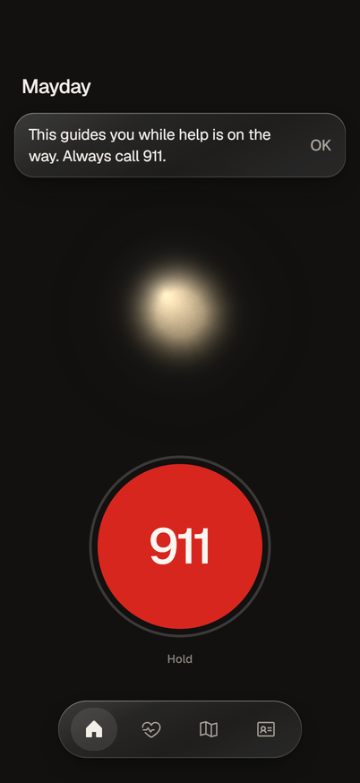
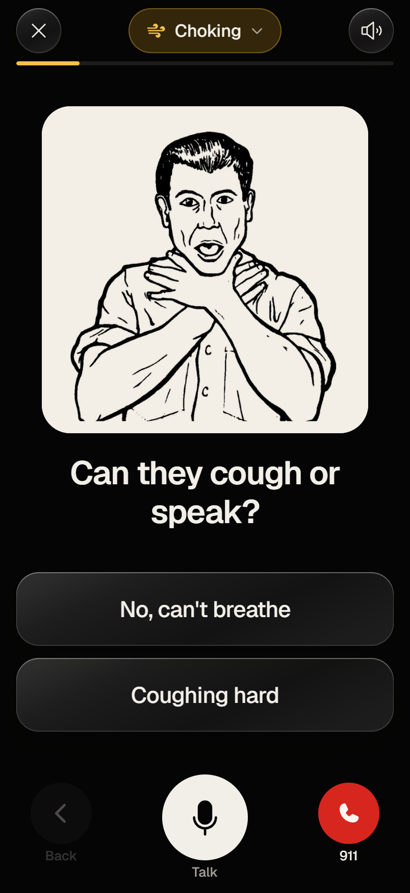
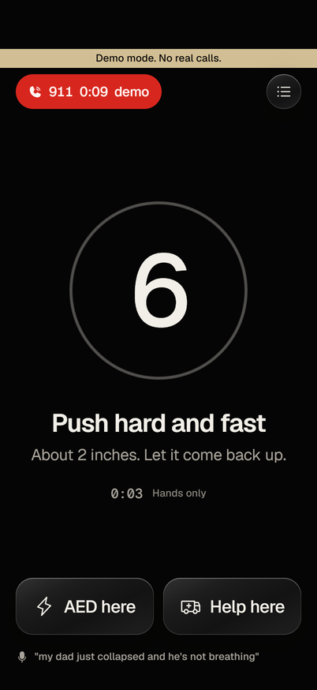
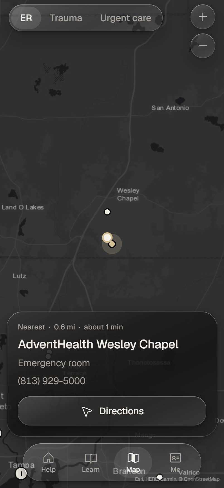
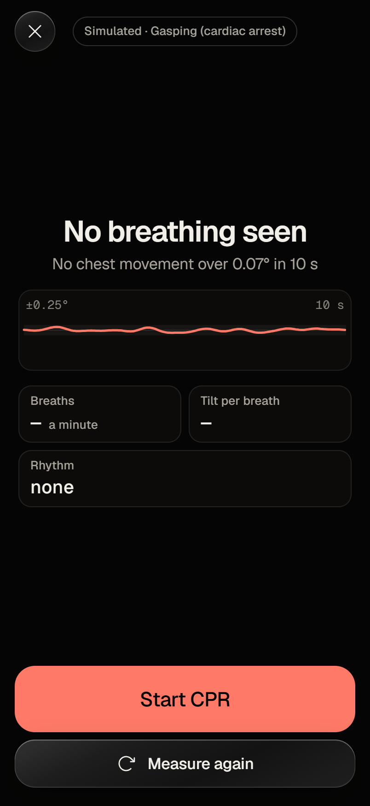
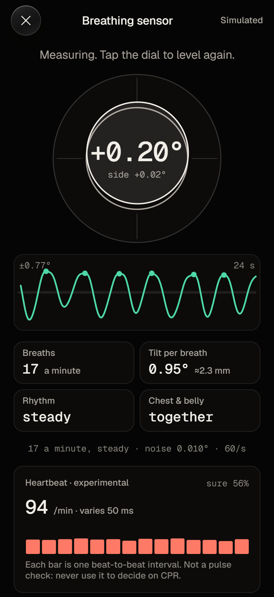
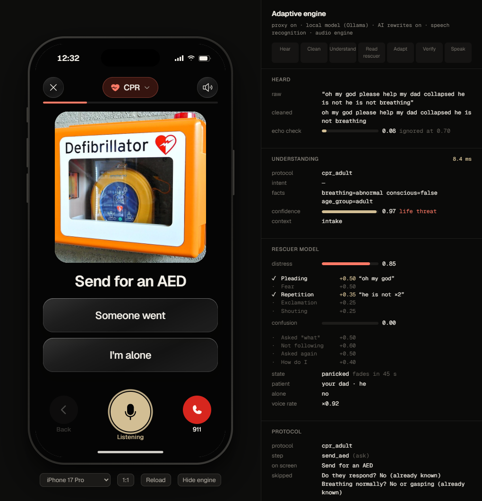

# Mayday

**Mayday talks a panicking bystander through a medical emergency, out loud and step by step, while help is on the way, even with no signal.**

Congressional App Challenge 2026. Expo (React Native, TypeScript) for iPhone and Android, with a web build that runs inside a life-size iPhone frame on any computer.

<p>




</p>

<p>


</p>

<p></p>

## What it does

Tap **Talk to Mayday** and say what is happening ("my dad collapsed and he's not breathing"), or tap the colored tile for the emergency. Mayday answers out loud, asks at most one question, and coaches you through the right protocol: one picture, one short instruction, big answer buttons, and a voice. Back, Talk and 911 sit under your thumb on every step. **Mayday never calls anyone.** You call 911; its 911 button shows your address and a summary to read to the dispatcher. At "Breathing normally?" you can lay the phone on their chest: it reads the chest's movement from the phone's tilt, to a hundredth of a degree, and can only ever tell you to start CPR sooner. For CPR it counts every compression out loud at 110 a minute, cues breaths if you are trained, tells you when to swap rescuers, and switches to AED steps the moment you say "the AED is here". It keeps a timestamped log to show the paramedics.

Ten protocols, every step cited: adult, child and infant CPR; adult and child choking; infant choking; severe bleeding; burns; stroke (FAST); opioid overdose with naloxone; recovery position.

## Why it's different

1. **The AI never writes medical instructions.** Every instruction comes from a protocol file with the guideline sentence it encodes. Models only pick which protocol fits and rephrase cited passages, and their output is schema-checked and discarded if it doesn't fit.
2. **It listens.** Speech in, voice out, interruptible, and honest when a phone call takes the microphone away.
3. **The metronome doesn't drift.** Beats are scheduled on the audio hardware clock. 10 simulated minutes with a deliberately bad timer: 1,100 beats, zero drift. A naive version is 2.2 seconds late.
4. **It knows which hospital.** 145 Florida emergency rooms, all 36 state trauma centers with levels, urgent care marked "not for emergencies". Offline.
5. **It works in a basement.** Protocols, voice, CPR coach and the hospital data need no signal.
6. **It is built for the 2025 guidelines**, which changed infant CPR (no more two fingers), adult choking (back blows first) and AED pads (a bra can be moved aside). Tests fail the build if those regress.

## Run it

**On this computer, as a phone:** double-click **Mayday Phone** on the desktop, or:

```powershell
cd mobile; npm install; npm run build:web
powershell -ExecutionPolicy Bypass -File ..\mirror\launch.ps1
```

That opens the real app in an iPhone 17 Pro frame at its true resolution: 402 × 874 points (1206 × 2622 pixels), one screen pixel per point. The **Engine** button opens a panel beside the phone that shows, live, what the app heard, what it decided and why. Mayday never calls anyone.

**On a phone:** `cd mobile && npx expo start`, then scan the QR code with Expo Go. Expo Go has no speech recognition, so there you tap instead of talk; the voice plays through expo-audio. For the full app build a development client: `npx expo run:android` or `eas build --profile development`.

**Tests:** `cd mobile && npm test` and `npx tsc --noEmit`. The breathing sensor's simulated bench: `SENSOR_REPORT=1 npx jest sensors` (results in [docs/SENSOR_SIM.md](docs/SENSOR_SIM.md)).

**AI features (optional):** `cd proxy && npm install && npm run dev` with keys in `proxy/.dev.vars`, then `EXPO_PUBLIC_PROXY_URL=http://localhost:8787` in `mobile/.env.local`. Without keys the app is complete; the photo check is hidden.

## How it works

Plain-language walkthrough, with a diagram and a three-sentence explanation of each part: **[docs/ARCHITECTURE.md](docs/ARCHITECTURE.md)**. Design rules: [design/SYSTEM.md](design/SYSTEM.md).

## Medical sources

Every spoken line, its source, and whether it has been verified: **[docs/MEDICAL_SOURCES.md](docs/MEDICAL_SOURCES.md)** (generated from the protocol files). Primary sources: 2025 American Heart Association Guidelines for CPR and ECC; 2024 AHA and American Red Cross Guidelines for First Aid; American Red Cross Scientific Advisory Council (burn cooling); American College of Surgeons STOP THE BLEED; NIH MedlinePlus. 64 of 78 steps are quoted from their source; 14 await review by a CPR-certified reviewer because the publisher blocks automated download, and they are marked in the app.

## Data sources

ERs: CMS Provider Data Catalog, Hospital General Information. Trauma centers: Florida Department of Health, Florida Trauma Centers (July 23 2026). Urgent care: OpenStreetMap contributors. Geocoding: U.S. Census Bureau. Statistics: CARES 2024 Metrics Summary. Map tiles: Esri, HERE, Garmin, OpenStreetMap. Voice: Piper (en_US-lessac-medium). Step pictures: Wikimedia Commons, public domain and Creative Commons ([credits](docs/IMAGE_CREDITS.md)).

## AI disclosure

AI tools were used in building Mayday, and the app uses AI models at runtime. Full list of what each tool did: **[submission/ai-disclosure.md](submission/ai-disclosure.md)**.

## Limitations

Read [docs/PROGRESS.md](docs/PROGRESS.md#known-limitations-say-them-dont-hide-them). In short: not yet tested on physical phones; 14 steps await medical review; the router gets 85% of unseen sentences right (its misses are listed); English only.

**Mayday guides you while help is on the way. Always call 911.** It is not a substitute for training or professional care, and it does not diagnose.

## Layout

```
mobile/      the app (Expo, TypeScript)          proxy/     model proxy (Cloudflare Worker)
mirror/      phone frame + launcher               tools/     Python: voice, map data, sources doc, icons
docs/        architecture, progress, sources      design/    design system
research/    findings and raw notes               submission/, video/   drafts for the team to rewrite
app/         the August 2026 Flutter prototype (superseded; its research and protocol content carried over)
```
