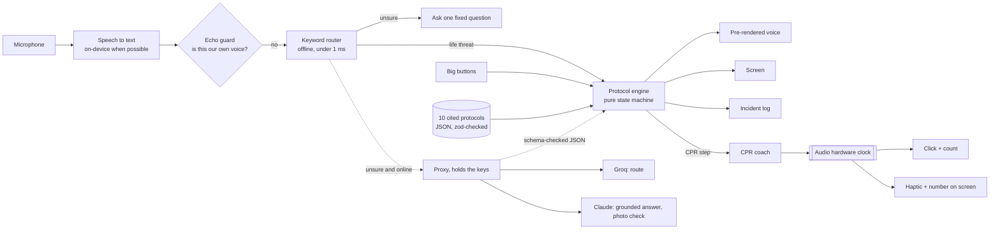

# How Mayday works

Plain language first, file names second. Each section ends with **three sentences you can say in the video**.

## The one rule

**The language model never writes medical instructions.** Every instruction the app shows or speaks comes from a protocol file a person wrote, with a citation, checked by tests. Models are allowed to do two narrow jobs: guess *which* protocol fits what someone said, and rephrase an answer *from passages we hand them*. Their output is checked against a schema and thrown away if it does not fit. If every model and every network disappeared, the app would still coach CPR.



## Layers and files

| Layer | What it does | Where |
|---|---|---|
| Protocols | 10 protocols, 78 steps, each with a source and a quote | `mobile/src/protocols/corpus/*.json`, schema in `schema.ts` |
| Engine | `(state, event) -> (new state, effects)`. No audio, no screen, no network | `mobile/src/protocols/engine.ts` |
| CPR coach | The timeline, the lookahead scheduler, the coach hook | `mobile/src/cpr/` |
| Audio | One engine on the Web Audio API, on phones via react-native-audio-api | `mobile/src/audio/` |
| Voice | Speech recognition, echo guard, keyword router, offline answers, model router | `mobile/src/voice/` |
| Incident | The controller tying it all together; the log and summary | `mobile/src/emergency/useIncident.ts`, `mobile/src/incident/log.ts` |
| Places | ERs, trauma centers, urgent care; nearest and care advice | `mobile/src/facilities/` |
| Design | Tokens, Liquid Glass, the orb shader, buttons, diagrams | `mobile/src/design/` |
| Screens | Expo Router routes | `mobile/src/app/` |
| Proxy | Keeps API keys off the phone; Groq and Claude | `proxy/src/index.ts` |
| Tools | Voice rendering, map data, medical sources doc, icons | `tools/*.py` |
| Phone mirror | The web build inside an iPhone frame | `mirror/` |

## 1. Protocols are data, not code

Each protocol is a JSON file: a list of steps. A step has a headline (5 words or fewer), spoken lines (12 words or fewer each), a picture, a source id, the quote from that source, and a `verified` flag. Steps have kinds: `do` (one action), `ask` (a question with answers), `cpr` (the compression coach), `hold` (keep pressure on until help comes), `timer` (cool a burn for 10 minutes), `end`. Answers point to the next step, or into another protocol (`@cpr_{age_group}#position`), and the `{age_group}` is filled from what we know, so a choking child who collapses lands in child CPR.

Tests (`mobile/__tests__/protocols.test.ts`) check every protocol on every run: every link resolves for every age, every step is reachable, every step has a known source, "verified" steps carry a real quote, no spoken line is over 12 words, no dashes, never "two fingers" on an infant (removed in 2025), choking starts with back blows (changed in 2025), a tourniquet is never loosened, burns never get ice.

> **Say it:** Our protocols aren't code, they're data: each step is a short instruction with the exact guideline sentence it came from. A test suite checks all 78 steps on every build, including the 2025 changes most first-aid apps still get wrong, like the end of two-finger infant CPR. If a step can't be traced to a source, the build fails.

## 2. The engine is a pure function

`reduce(state, event)` takes where we are and what just happened (a tap, a recognised phrase, a timer firing) and returns where we are now plus a list of effects: say these lines, write this to the log. It never plays a sound or draws anything itself. That is why it is testable: `engine.test.ts` walks every branch of every protocol without a phone.

Two details worth explaining: if the router already heard "he's not breathing", an `ask` step whose answer is known is **skipped** and logged as "already known"; and **interrupts** like "the AED is here" or "he's throwing up" jump to the right step from anywhere in the protocol.

> **Say it:** The engine is a pure function: give it the current step and an event, it gives back the next step and what to say. Because it never touches the screen or the speaker, we can test every path through every protocol in a few seconds. If you've already told it he isn't breathing, it skips that question instead of asking you again.

## 3. The CPR coach runs on the audio clock

The hard problem: JavaScript timers drift. `setTimeout(545)` fires 545 ms later *or more*, and over ten minutes those small delays add up. In our simulation a naive metronome is **2.2 seconds late** after 10 minutes, and CPR instructors can hear that.

The fix has three parts:

1. **`timeline.ts`**: every click and count is a pure function of the start time: beat *n* is at `t0 + n × 60/110`. Never "previous beat plus a period", so nothing accumulates.
2. **`scheduler.ts`**: a JavaScript timer wakes every ~25 ms (late, jittery, doesn't matter), looks 200 ms ahead, and hands every event in that window to the **audio hardware** with an exact start time. The hardware plays it sample-accurately.
3. **`useCprCoach.ts`**: the number on screen and the haptic tick don't keep their own time. Every frame they read the same audio clock and ask the timeline "which beat is it?" Sound, screen and buzz can't disagree.

Hands-only cycles are 30 counted beats then 6 quiet beats with one coaching line ("Push hard. Push fast.", "Has anyone found an AED?"). With breaths: 30 counts, then a timed breath window under 10 seconds. Every 2 minutes, anchored to the clock (2:00, 4:00, not "2 minutes after the last one"), it says "Four minutes. Switch with someone if you can."

Counts are pre-recorded (`tools/render_voice.py`, Piper neural voice), each squeezed to fit inside one beat (the longest, "twenty three", is 0.415 s; a beat is 0.545 s). A test checks every count fits.

Evidence: `mobile/__tests__/metronome.test.ts` drives the scheduler for 10 simulated minutes with a timer that is randomly 0 to 60 ms late every tick: 1,100 beats, **maximum error 0.0000000001 ms**. Report: `mobile/reports/metronome-drift.json`.

> **Say it:** JavaScript timers drift, so in ten minutes a normal metronome ends up over two seconds late. We schedule every beat on the phone's audio hardware clock a fifth of a second ahead, and the number on screen and the vibration read that same clock. Our test runs ten simulated minutes with a deliberately bad timer and every one of the 1,100 beats lands exactly on time.

## 4. Voice: fast, interruptible, honest about being deaf

- **Listening** (`voice/listen.ts`): the phone's speech recogniser, on-device when supported, in voice-chat mode so the phone's echo cancellation subtracts our own speaker from the mic. Web preview: the browser's Web Speech API.
- **Echo guard** (`voice/echo.ts`): if a transcript is only counting words, or mostly words we just said, it is our own voice and is ignored.
- **Barge-in**: as soon as the person says two words, we stop talking.
- **Keyword router** (`voice/router.ts`): cleans panicked speech ("he's not, he's not breathing" becomes "he is not breathing"), pulls out facts (age, breathing, conscious, wound site), and picks a protocol. Life-threat words start the protocol **before any model is asked**.
- **Model router** (`voice/llmRouter.ts`, Groq through the proxy): asked only when the keywords are unsure, 1.2 second deadline, output must parse with zod or it is discarded.
- **Answers to open questions** (`voice/answer.ts`, `voice/answers.json`): 23 hand-written answer cards ("should I move him?", "do I have to take her bra off?", "can I loosen the tourniquet?"), each with the ways people ask it, a short spoken answer and a source. Matching weights words by rarity, so "take her bra off" can't match "take the tourniquet off", and a card only answers inside its own protocols. Below a 0.6 match score it does not guess: "Keep doing compressions. Tell the dispatcher that." Online, Claude may rephrase, but only from the cards we picked. 21 tests pin the right answer for real questions, including near-misses that must not answer.
- **The phone call takes the microphone.** On both iOS and Android an app cannot hear during a cellular call (research in `research/DECISIONS.md`). When that happens the app says "I can't hear you during the call. Tap the screen instead." rather than pretending to listen.

Evaluation: 47 messy intake sentences + 24 in-protocol commands, **100%** on the set it was tuned on; and a **held-out** set of 20 new sentences written after tuning: **85%** (17/20), and every not-breathing sentence started CPR. The three misses are listed in `mobile/reports/router-heldout.json`; each one still lands on a protocol that begins with a safety check.

> **Say it:** The first thing that hears you is a set of rules that runs offline in under a millisecond, and anything that sounds like a life threat starts the protocol immediately. A language model can only help when the rules are unsure, and its answer has to fit a strict schema or we throw it away. On sentences it had never seen, it picked the right protocol 85% of the time, and it never missed someone who wasn't breathing.

## 5. 911, honestly

Neither iOS nor Android lets an app dial 911 silently, and that is the right rule. So: a 5-second ring you can cancel, then the phone's own dialer (one confirming tap on iOS). "Already called" lets a bystander say someone else is on the phone, which is what CPR courses teach anyway. The "Tell the dispatcher" card shows the street address (reverse-geocoded), GPS coordinates with accuracy, and a one-line summary built by a template from the log, never by a model: *"Adult (age not given), unresponsive, not breathing normally. CPR started 3:01 PM."* Text-to-911 opens Messages with that text pre-filled (availability varies by county).

**DEMO_MODE** is on in every development build and the web preview. It never dials 911: it shows a simulated call, or dials a team member's number. A store build turns it off at build time; nothing inside the app can.

> **Say it:** Phones don't let apps dial 911 by themselves, so Mayday gives you five seconds to cancel and then hands the call to the phone, with your address and a one-line summary ready to read out. That summary is filled in from what actually happened, never written by AI. In every test build the call is simulated, so we can never reach a real dispatcher by accident.

## 6. The right hospital

Most "nearest hospital" features are wrong because not every hospital has an emergency department and few are trauma centers. `tools/build_facilities.py` builds the offline map data from three public sources: **145 Florida ERs** (CMS Hospital General Information, `emergency_services = Yes`), **all 36 Florida trauma centers with their levels** (Florida Department of Health list, July 23 2026, matched to CMS records by name and, where names differ, by street address), and **25 Tampa Bay urgent cares** (OpenStreetMap), labelled "not for emergencies". Coordinates come from the U.S. Census geocoder, with OpenStreetMap for the ones it can't match.

Which place to suggest is decided by the protocol's `care` field, not a model: cardiac arrest, stroke and major bleeding say "Stay. Paramedics are coming. Do not drive." and show where EMS is likely to go; a minor burn may suggest urgent care.

> **Say it:** Not every hospital has an emergency room and only 36 in Florida are trauma centers, so we built our own map data from the federal hospital database and the state's trauma center list. It's bundled in the app, so it works with no signal. And for a cardiac arrest the app tells you to stay put, because the ambulance is faster than you are.

## 7. Liquid Glass and the orb

On iOS 26 the controls are Apple's real Liquid Glass. In the web preview we rebuild the effect: a displacement map computed for each control's exact shape bends the background at the rim like the curved edge of a lens (`design/Glass.web.tsx`). The orb is one fragment shader in SkSL running on the GPU through Skia: a breathing sphere of light that swells when you speak and pulses on every compression (`design/Orb.tsx`).

> **Say it:** The calm screens use Apple's Liquid Glass, and in our web preview we recreate it by computing how a curved lens would bend the background at each button's edge. The breathing light is a GPU shader we wrote, which reacts to your voice and pulses with every compression. In emergency mode all of that disappears: black screen, huge type, one thing to do.

## 8. The proxy keeps keys off the phone

`proxy/src/index.ts` is a Cloudflare Worker (and a plain Node server for local work). The phone never holds an API key. The proxy rate-limits each caller (20 requests, refilling one every 3 seconds), validates every request with zod, calls Groq or Claude, and validates every answer: `/ask` must cite passages it was given and keep each sentence to 12 words; `/scan` must start "This looks consistent with" or "I can't tell" and may only suggest `burns` or `bleeding`. Claude calls use `claude-opus-5-5` with server-side refusal fallbacks enabled.

> **Say it:** API keys never ship inside the app, because anyone can pull them out of an app download. The app talks to our own small server, which checks every request, limits how often each phone can call, and checks every AI answer before passing it on. If the AI's answer doesn't cite our sources, the server throws it away.

## 9. Offline

Works with no signal: the protocols, the keyword router, the voice (pre-recorded), the CPR coach, the 911 dialer, the dispatcher card's coordinates, and the ER and trauma data. Needs signal: the map's background tiles, the street address (on web), Groq, Claude, and the photo check. Speech recognition is on-device on most recent phones.

> **Say it:** Emergencies happen in parking garages and basements, so everything that keeps someone alive works in airplane mode. The AI features are extras that switch on when there is signal. Turn off the network mid-CPR and the count doesn't miss a beat.

## Running it

```bash
cd mobile && npm install
npm test                 # 145 tests: protocols, engine, metronome, router, voice clips
npx tsc --noEmit         # typecheck
npx expo start           # phone: scan the QR code (Expo Go: no speech recognition or audio engine)
npm run build:web        # web build for the phone mirror
# then double-click "Mayday Phone" on the desktop, or:
powershell -ExecutionPolicy Bypass -File ..\mirror\launch.ps1
```

Full features on a phone need a development build (`npx expo run:android`, or `eas build --profile development`), because the speech recogniser and the audio engine are native modules that Expo Go does not include.
